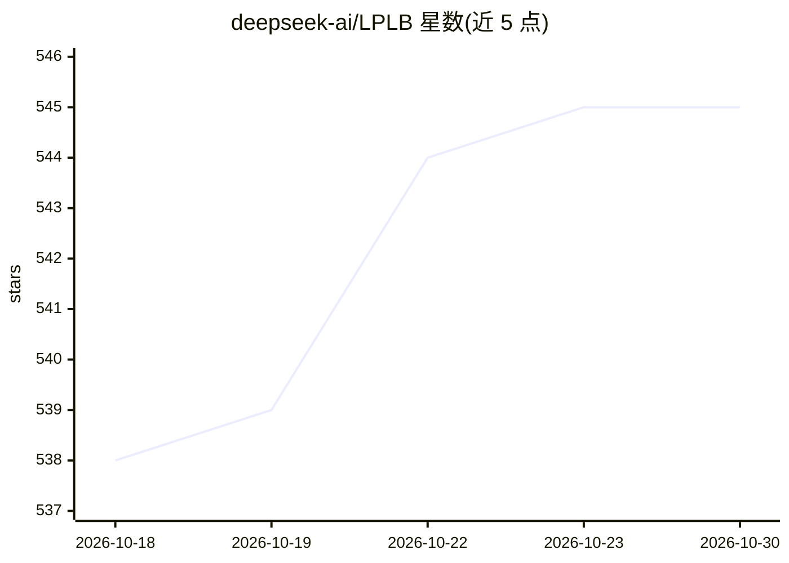

# deepseek-ai/LPLB

⭐ 545 · Python · MIT · 推送 2025-11-19 · [GitHub](https://github.com/deepseek-ai/LPLB) · 组织维护

**面向 MoE 模型训练的专家并行负载均衡器，基于线性规划**

DeepSeek 团队的专家并行负载均衡研究项目：扩展 EPLB，解决 MoE 训练中小批量随机性导致的逐批次动态负载失衡。机制包括按工作负载统计重排专家、考虑静态拓扑构建冗余专家副本（Cube/Hypercube/Torus 拓扑）、用内点法 LP 求解每批次的 token 最优分配，LP 求解器基于 cuSolverDx/cuBLASDx 实现。官方声明处于早期研究阶段，性能仍在评估；存在仅均衡 token 总数、求解耗时约 100 µs 等限制。面向使用专家并行的 MoE 训练开发者，需要 CUDA 环境，推荐配合 DeepEP。

## 筛选速览

| 维度 | 判定 | 备注 |
|---|---|---|
| AI 角色 | `ai-ecosystem` | LLM/agent 周边工具 |
| 许可风险 | `permissive` | MIT |
| 部署形态 | `library` | 以包/库形式分发 |
| 模型依赖 | — | README 未给出锁定关系 |
| 硬件要求 | — | 无带数字的原话,不猜 |
| 安装摩擦 | `medium` | 含编译或系统依赖之一 |
| 成熟度 | `idea` | |

## 能力要点

- 线性规划（内点法）求解逐批次 token 分配，实现动态负载均衡
- 支持 Cube/Hypercube/Torus 等冗余专家拓扑，可自定义 r2o 矩阵
- 通过 NVLINK 与 NVSHMEM 优化实时工作负载同步（需 DeepEP）
- 嵌入基于 cuSolverDx/cuBLASDx 的单 SM LP 求解器

## 适用场景

- MoE 模型训练中缓解逐批次专家负载失衡
- 在专家并行（EP）组内降低负载不均带来的性能波动
- 研究不同冗余专家拓扑对负载均衡的影响

## 场景标签

`模型训练` · 领域:训练与推理

## 证据(README 行号)

> L3: LPLB is a parallel load balancer that leverages linear programming to optimize expert parallel workload distribution
> L5: LPLB is currently in the early research stage, and performance improvements are still under evaluation.
> L39: LPLB extends **EPLB** (Expert Parallelism Load Balancer) to address **dynamic load imbalance** in Mixture-of-Expert

## 星数曲线

2026-10-18 538 → 2026-10-30 545（+7）

---
*卡片 v1 · prompt 1.4 · 生成 2026-10-21 · 置信度 high · 依据 README sha `752dae4a28c6` · [字段定义](../../DATASET.md)*
