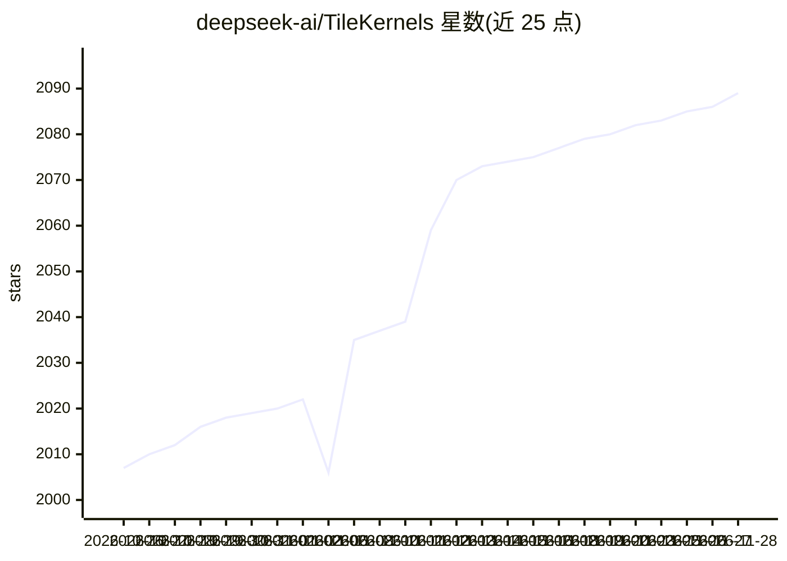

# deepseek-ai/TileKernels

⭐ 2,089 · Python · MIT · 推送 2026-11-27 · [GitHub](https://github.com/deepseek-ai/TileKernels) · 组织维护 · 中文 README

**LLM 训练推理算子库：以 TileLang 编写、支持 NVIDIA 与昇腾**

TileKernels 提供数十个以领域专用语言 TileLang 实现的算子，覆盖 LLM 训练与推理中的常见操作：MoE 路由、Engram 门控（含融合 RMSNorm 与反向传播）、FP8/FP4 量化转换与融合 SwiGLU+量化、流形超连接（含 Sinkhorn 归一化）以及 RoPE 变换等；提供 torch.autograd.Function 高层封装与 pytest 测试体系。支持 NVIDIA SM90/SM100 与华为昇腾 950 两种后端，运行时自动选择；全部算子已在作者内部训练推理任务中使用。以 pip 包分发，需 Python 3.12+、PyTorch 2.13+。

## 筛选速览

| 维度 | 判定 | 备注 |
|---|---|---|
| AI 角色 | `ai-ecosystem` | LLM/agent 周边工具 |
| 许可风险 | `permissive` | MIT |
| 部署形态 | `library` | 以包/库形式分发 |
| 模型依赖 | — | README 未给出锁定关系 |
| 硬件要求 | — | 无带数字的原话,不猜 |
| 安装摩擦 | `medium` | 含编译或系统依赖之一 |
| 成熟度 | — | 结构信号不足 |

## 能力要点

- 数十个 TileLang 编写的算子，覆盖 MoE 路由、量化、Engram、mHC、RoPE
- 双硬件后端：NVIDIA GPU 与华为昇腾 NPU，运行时自动选择
- 提供 Engram 门控的 torch.autograd.Function 高层封装
- pytest 测试体系支持正确性校验与 benchmark

## 适用场景

- 为 LLM 训练/推理任务调用现成的 MoE 路由与量化算子
- 在华为昇腾 NPU 上复用同一套 Python 算子 API
- 基于 TileLang 开发自定义算子时参考实现

## 场景标签

`模型训练` · 领域:训练与推理

## 证据(README 行号)

> L3: TileKernels is a library of dozens of highly optimized kernels implemented in TileLang, a domain-specific language s
> L9: - **[2026-09-30] Huawei Ascend support**: Added Huawei Ascend support and updated the usage documentation. Following
> L26: - CUDA Backend

## 星数曲线

2026-10-26 2,007 → 2026-11-28 2,089（+82）

---
*卡片 v1 · prompt 1.4 · 生成 2026-11-28 · 置信度 mid · 依据 README sha `aa43008a9cb5` · [字段定义](../../DATASET.md)*
