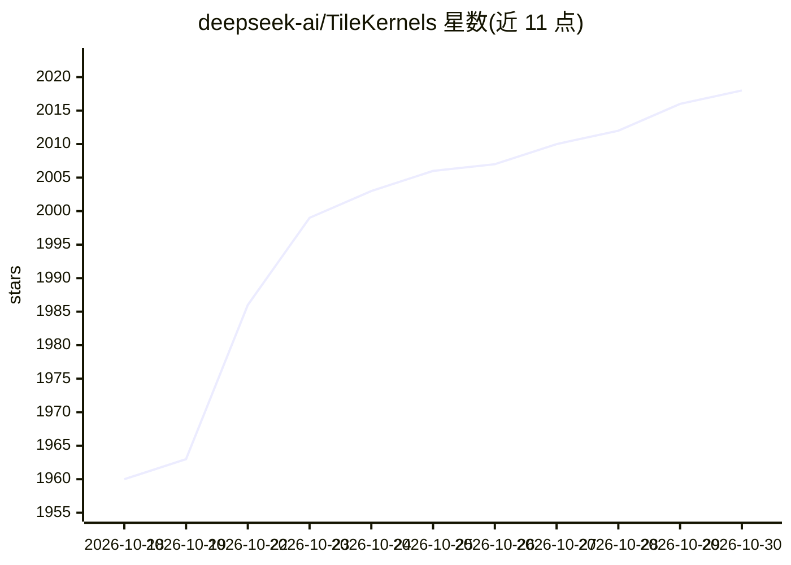

# deepseek-ai/TileKernels

⭐ 2,018 · Python · MIT · 推送 2026-10-14 · [GitHub](https://github.com/deepseek-ai/TileKernels) · 组织维护 · 中文 README

**基于 TileLang 的 LLM 训练/推理高性能算子库**

deepseek-ai 维护的算子库，用领域专用语言 TileLang 实现数十个优化算子，覆盖 MoE 路由、量化（FP8/FP4）、Engram 门控、流形超连接、RoPE 等大模型训练与推理常见操作，并提供 torch.autograd.Function 高层封装。支持 NVIDIA（SM90/SM100）与华为昇腾 950 NPU 双后端，运行时自动选择，同一 Python API 通用。所有算子已用于内部训练与推理任务。以 pip 包或本地开发模式安装。

## 筛选速览

| 维度 | 判定 | 备注 |
|---|---|---|
| AI 角色 | `ai-ecosystem` | LLM/agent 周边工具 |
| 许可风险 | `permissive` | MIT |
| 部署形态 | `library` | 以包/库形式分发 |
| 模型依赖 | — | README 未给出锁定关系 |
| 硬件要求 | — | 无带数字的原话,不猜 |
| 安装摩擦 | `medium` | 含编译或系统依赖之一 |
| 成熟度 | — | 结构信号不足 |

## 能力要点

- MoE 路由、FP8/FP4 量化、Engram 门控、流形超连接等数十个 TileLang 算子
- NVIDIA GPU 与华为昇腾 NPU 双后端，运行时自动选择
- 提供 torch.autograd.Function 高层封装
- 全部算子已用于内部训练与推理工作负载

## 适用场景

- 为大模型训练与推理接入高性能 MoE 路由和量化算子
- 在 NVIDIA 或昇腾硬件上复用统一的算子 API
- 研究 Engram、流形超连接等新结构的算子实现

## 场景标签

`模型量化` `模型训练` · 领域:训练与推理

## 证据(README 行号)

> L3: TileKernels is a library of dozens of highly optimized kernels implemented in TileLang, a domain-specific language s
> L9: - **[2026-09-30] Huawei Ascend support**: Added Huawei Ascend support and updated the usage documentation. Following

## 星数曲线

2026-10-18 1,960 → 2026-10-30 2,018（+58）

---
*卡片 v1 · prompt 1.4 · 生成 2026-10-21 · 置信度 high · 依据 README sha `5cca427bc830` · [字段定义](../../DATASET.md)*
