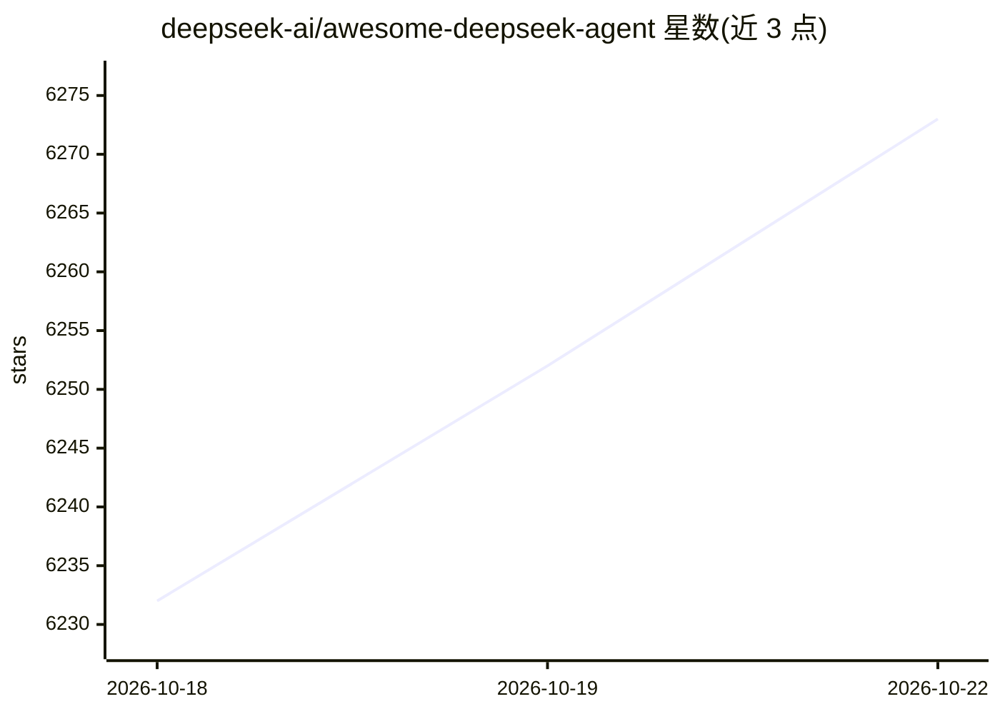

# deepseek-ai/awesome-deepseek-agent

⭐ 6,273 · 推送 2026-09-17 · [GitHub](https://github.com/deepseek-ai/awesome-deepseek-agent) · 组织维护 · 中文 README

**将 DeepSeek 模型接入 AI agent 与编码助手工具的指南清单**

由 deepseek-ai 维护的策展清单：汇集将 DeepSeek 模型（如 DeepSeek-V4-Pro、DeepSeek-V4-Flash）集成到主流 AI agent 与编码助手工具的指南，每份指南覆盖安装、配置与首次运行步骤，读者可在数分钟内在常用工具中使用 DeepSeek 模型。另列出 DeepSeek 平台（获取 API key）与 API 文档等资源链接，接受社区贡献。以 Markdown 清单形式提供，无需安装运行。

## 筛选速览

| 维度 | 判定 | 备注 |
|---|---|---|
| AI 角色 | `ai-knowledge` | 知识聚合/清单类 |
| 许可风险 | `none` | — |
| 部署形态 | `None` |  |
| 模型依赖 | — | README 未给出锁定关系 |
| 硬件要求 | — | 无带数字的原话,不猜 |
| 安装摩擦 | `low` | 无编译、无系统依赖或容器化 |
| 成熟度 | — | 结构信号不足 |

## 能力要点

- 汇集将 DeepSeek 模型接入 AI agent 与编码助手工具的指南
- 每份指南覆盖安装、配置与首次运行步骤
- 列出 DeepSeek 平台 API key 获取与 API 文档资源

## 适用场景

- 查找在常用编码助手中配置 DeepSeek 模型的步骤
- 了解哪些 AI agent 工具已提供 DeepSeek 接入指南

## 场景标签

`精选清单` · 领域:学习与行业

## 证据(README 行号)

> L5: A curated list of guides for integrating **DeepSeek** models into popular AI agent and coding-assistant tools.
> L7: Each guide walks through installation, configuration, and first run — so you can start using DeepSeek-V4-Pro or Deep

## 星数曲线

2026-10-18 6,232 → 2026-10-22 6,273（+41）

---
*卡片 v1 · prompt 1.4 · 生成 2026-10-20 · 置信度 high · 依据 README sha `a2999229f1a5` · [字段定义](../../DATASET.md)*
