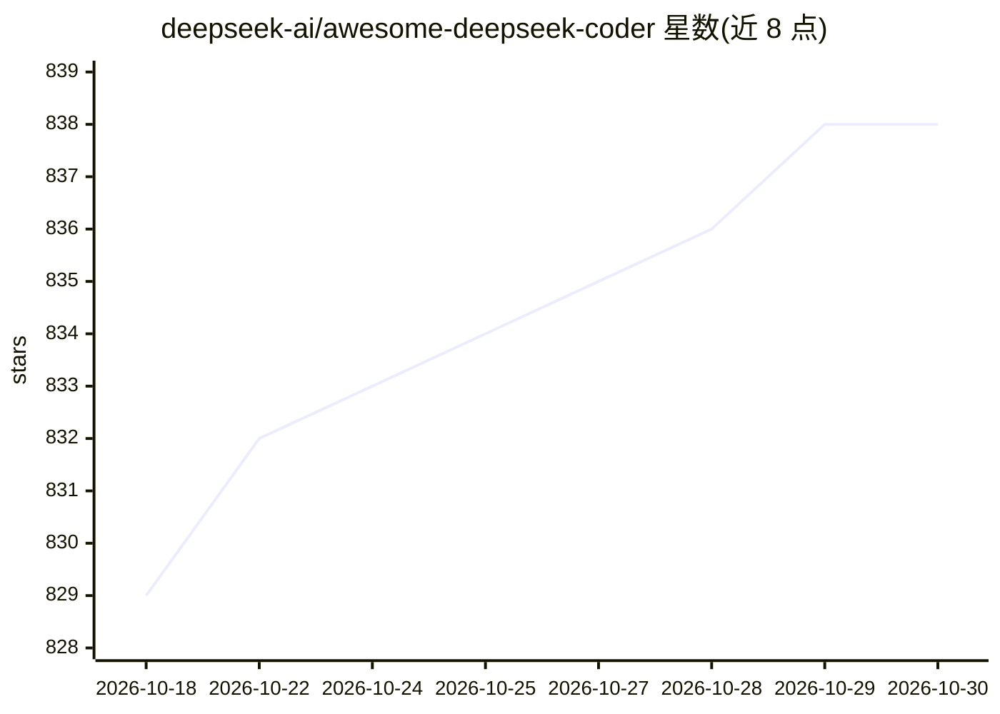

# deepseek-ai/awesome-deepseek-coder

⭐ 838 · 推送 2025-11-11 · [GitHub](https://github.com/deepseek-ai/awesome-deepseek-coder) · 组织维护 · 中文 README

**DeepSeek Coder 相关开源项目策展清单**

由 deepseek-ai 维护的 awesome 清单，收录与 DeepSeek Coder 模型相关的开源项目。内容分官方资源（4 个规模 Base/Instruct 模型、Hugging Face 入口）与社区资源：基于 DeepSeek Coder 构建的第三方模型（OpenCodeInterpreter、Magicoder、WizardCoder 等）、TheBloke 提供的 AWQ/GGUF/GPTQ 量化模型文件、refact/Tabby/AutoDev 等 AI 编码助手与相关 API。README 同时提供中英文版本，无本产品安装命令。面向寻找 DeepSeek Coder 生态资源的开发者和使用者。

## 筛选速览

| 维度 | 判定 | 备注 |
|---|---|---|
| AI 角色 | `ai-knowledge` | 知识聚合/清单类 |
| 许可风险 | `none` | — |
| 部署形态 | `None` |  |
| 模型依赖 | locked-api |  |
| 硬件要求 | — | 无带数字的原话,不猜 |
| 安装摩擦 | `low` | 无编译、无系统依赖或容器化 |
| 成熟度 | — | 结构信号不足 |

## 能力要点

- 收录 1.3B/5.7B/6.7B/33B 四个规模的官方 Base 与 Instruct 模型
- 列出基于 DeepSeek Coder 构建的第三方模型（OpenCodeInterpreter、Magicoder、WizardCoder 等）
- 收录 TheBloke 的 AWQ/GGUF/GPTQ 量化模型文件
- 收录 refact、Tabby、AutoDev 等 AI 编码助手对接信息

## 适用场景

- 查找 DeepSeek Coder 各规模模型及 Hugging Face 下载入口
- 寻找基于 DeepSeek Coder 微调或量化的社区模型
- 选择支持 DeepSeek Coder 的开源编码助手

## 场景标签

`精选清单` · 领域:学习与行业

## 证据(README 行号)

> L7: A curated list of open-source projects related to DeepSeek Coder.
> L9: ## Chat with DeepSeek Coder

## 星数曲线

2026-10-18 829 → 2026-10-30 838（+9）

---
*卡片 v1 · prompt 1.4 · 生成 2026-10-21 · 置信度 high · 依据 README sha `b8b2e82a482d` · [字段定义](../../DATASET.md)*
