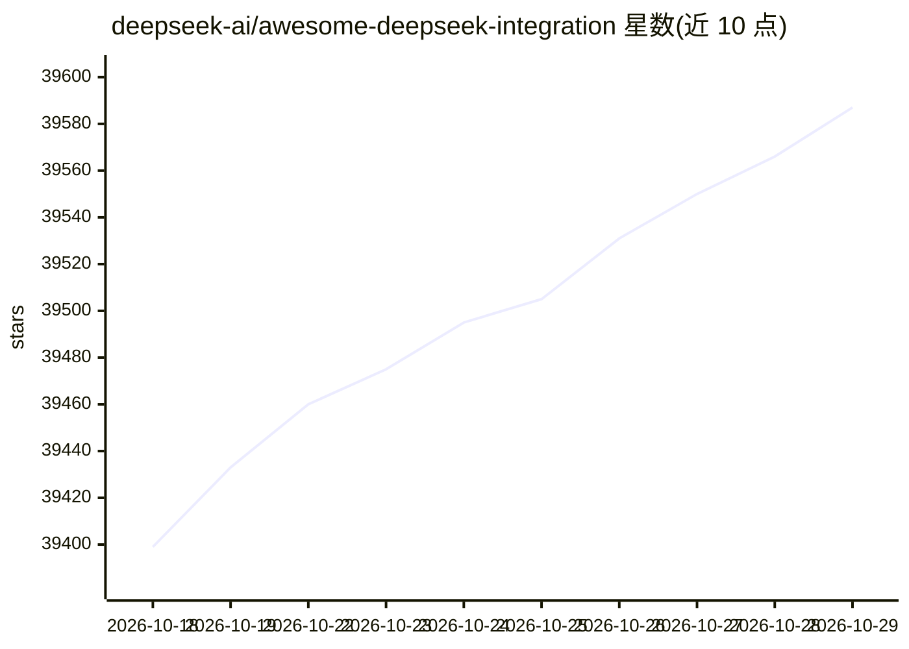

# deepseek-ai/awesome-deepseek-integration

⭐ 39,587 · CC0-1.0 · 推送 2026-02-23 · [GitHub](https://github.com/deepseek-ai/awesome-deepseek-integration) · 组织维护 · 中文 README

**将 DeepSeek API 接入常用软件的项目清单**

由 deepseek-ai 组织维护的聚合清单，收录将 DeepSeek API 集成到各类软件的项目条目，按应用、客户端库等类别组织。条目涵盖桌面/移动端聊天客户端、翻译与 OCR 工具、笔记与知识库软件、浏览器、RPA 客服、Zotero 插件，以及 PHP/Go/Swift 等 API 客户端库和 Laravel 封装。提供英语、简体中文、繁体中文、日语、西班牙语多个语言版本。清单本身不含安装步骤，各条目链接至各自仓库。

## 筛选速览

| 维度 | 判定 | 备注 |
|---|---|---|
| AI 角色 | `ai-ecosystem` | LLM/agent 周边工具 |
| 许可风险 | `viral` | CC0-1.0 |
| 部署形态 | `library` | 以包/库形式分发 |
| 模型依赖 | locked-api |  |
| 硬件要求 | — | 无带数字的原话,不猜 |
| 安装摩擦 | `low` | 无编译、无系统依赖或容器化 |
| 成熟度 | — | 结构信号不足 |

## 动量与使用信号

- 维护:`declining` — 距上次 push 236.6 天,年发版 0,233 位贡献者
- 涨星:近 1 天 **+15**(自 20261016 起算)
- 安装:github 包 `release-assets` 月下载无数据
- 平台:ANDROID / IOS · 协议:OPENAI-API / MCP / OLLAMA

## 能力要点

- 收录数十个接入 DeepSeek API 的应用与工具条目
- 包含 PHP、Go、Swift 语言的 DeepSeek API 客户端库条目
- 提供英语、简体中文、繁体中文、日语、西班牙语版本

## 适用场景

- 查找支持接入 DeepSeek API 的桌面或移动端客户端
- 为自己的技术栈寻找 DeepSeek API 的客户端库
- 浏览 DeepSeek 生态中已集成的软件列表

## 场景标签

`精选清单` · 领域:学习与行业

## 证据(README 行号)

> L3: # Awesome DeepSeek Integrations Awesome
> L5: Integrate the DeepSeek API into popular softwares. Access DeepSeek Open Platform to get an API key.
> L11: ## Table of Contents

## 星数曲线

2026-10-18 39,399 → 2026-10-29 39,587（+188）

---
*卡片 v1 · prompt 1.4 · 生成 2026-10-18 · 置信度 high · 依据 README sha `35018b0812f0` · [字段定义](../../DATASET.md)*
