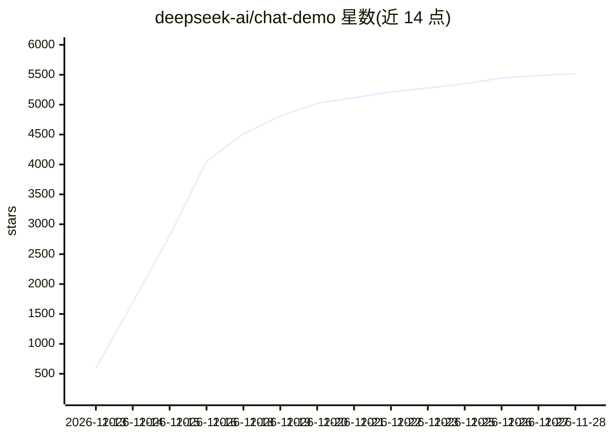

# deepseek-ai/chat-demo

⭐ 5,519 · TypeScript · MIT · 推送 2026-11-24 · [GitHub](https://github.com/deepseek-ai/chat-demo) · [官网](https://deepseek-ai.github.io/chat-demo/) · 组织维护 · 中文 README

**基于 DeepSeek API 的静态网页聊天演示应用**

DeepSeek 官方推出的纯前端聊天 Demo：浏览器直连配置的 API 服务，无需后端。功能含多会话管理、流式回复与深度思考、附件上传、语音输入与朗读、Markdown/KaTeX/Mermaid 渲染、中英双语与主题切换。API key 与设置存 localStorage，会话存 IndexedDB。默认通过 Anthropic 兼容 Messages/Files API 调用 deepseek-flash，语音走 ASR/TTS 端点；可下载 Releases 直接打开 index.html，或用 pnpm 从源码构建静态站点部署。

## 筛选速览

| 维度 | 判定 | 备注 |
|---|---|---|
| AI 角色 | `ai-native` | 本体是模型或模型工具 |
| 许可风险 | `permissive` | MIT |
| 部署形态 | `library` | 以包/库形式分发 |
| 模型依赖 | locked-api |  |
| 硬件要求 | — | 无带数字的原话,不猜 |
| 安装摩擦 | `low` | 无编译、无系统依赖或容器化 |
| 成熟度 | — | 结构信号不足 |

## 能力要点

- 浏览器直连 API 服务，无需应用后端
- 多会话、消息分支切换、流式回复与深度思考
- 附件上传、语音输入与朗读
- 支持中英双语、明暗主题与移动端布局

## 适用场景

- 快速体验 DeepSeek API 的网页聊天界面
- 作为静态聊天客户端自行部署到任意静态服务器
- 本地双击 index.html 免安装使用

## 场景标签

`聊天机器人` · 领域:对话与助手

## 证据(README 行号)

> L5: A static chat demo powered by the DeepSeek API. No application backend is required: the browser connects directly to
> L58: Chat uses `deepseek-flash` by default through Anthropic-compatible Messages / Files APIs. Speech features use ASR /

## 星数曲线

2026-11-13 596 → 2026-11-28 5,519（+4,923）

---
*卡片 v1 · prompt 1.4 · 生成 2026-11-17 · 置信度 mid · 依据 README sha `d939d89eaeb9` · [字段定义](../../DATASET.md)*
