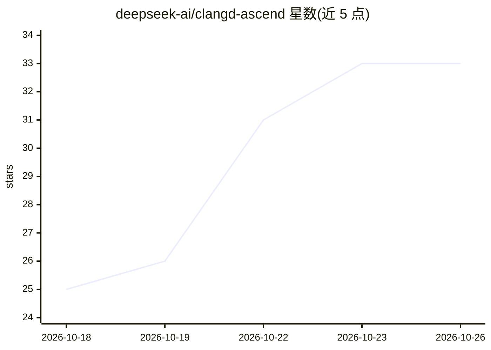

# deepseek-ai/clangd-ascend

⭐ 33 · C++ · NOASSERTION · 推送 2026-09-29 · [GitHub](https://github.com/deepseek-ai/clangd-ascend) · 组织维护 · 中文 README

**为 AscendC 算子开发定制的 clangd 语言服务器**

deepseek-ai 维护的 clangd 定制版本，面向华为昇腾 AscendC 算子（kernel）开发者：为 .asc 文件提供代码补全、诊断、跳转等 LSP 功能，支持大部分 AscendC 内建类型、地址空间与内核启动语法，并通过 include/cce_stubs/ 头文件提供内建函数声明。构建需先下载 LLVM 并从源码编译，产物与头文件安装到 ~/.ascend-clangd/，CANN 头文件默认从 /usr/local/Ascend/cann 读取，可用 --cann-path 指定；支持本地项目与用户级两种安装模式，编辑器需将 clangd 路径指向 ~/.ascend-clangd/bin/clangd。MIT 许可。

## 筛选速览

| 维度 | 判定 | 备注 |
|---|---|---|
| AI 角色 | `ai-ecosystem` | LLM/agent 周边工具 |
| 许可风险 | `none` | NOASSERTION |
| 部署形态 | `None` |  |
| 模型依赖 | — | README 未给出锁定关系 |
| 硬件要求 | — | 无带数字的原话,不猜 |
| 安装摩擦 | `low` | 无编译、无系统依赖或容器化 |
| 成熟度 | — | 结构信号不足 |

## 能力要点

- 为 .asc 文件提供补全、诊断、跳转等 clangd 功能
- 支持大部分 AscendC 内建类型、地址空间与内核启动语法
- include/cce_stubs/ 头文件声明内建函数
- 本地/用户级两种安装模式，可自定义 CANN 头文件路径

## 适用场景

- 昇腾算子开发时在编辑器中获得 .asc 文件补全与诊断
- 在多个项目中统一配置 AscendC 语言服务
- 跨项目共享同一份定制的 clangd 配置

## 场景标签

 · 领域:AI 芯片开发工具

## 证据(README 行号)

> L3: clangd-ascend is a customized version of clangd for AscendC, providing code
> L5: kernel development. It supports most AscendC builtin types, address spaces, and
> L9: clangd-ascend 是对 AscendC 定制的 clangd，能够为 `.asc` 文件提供代码补全、诊断、跳转等功能，为算子开发提供辅助。clangd-ascend 支持大部分 AscendC 的内建类型、地址空间和内核

## 星数曲线

2026-10-18 25 → 2026-10-26 33（+8）

---
*卡片 v1 · prompt 1.4 · 生成 2026-10-25 · 置信度 high · 依据 README sha `d62b2d047ae4` · [字段定义](../../DATASET.md)*
