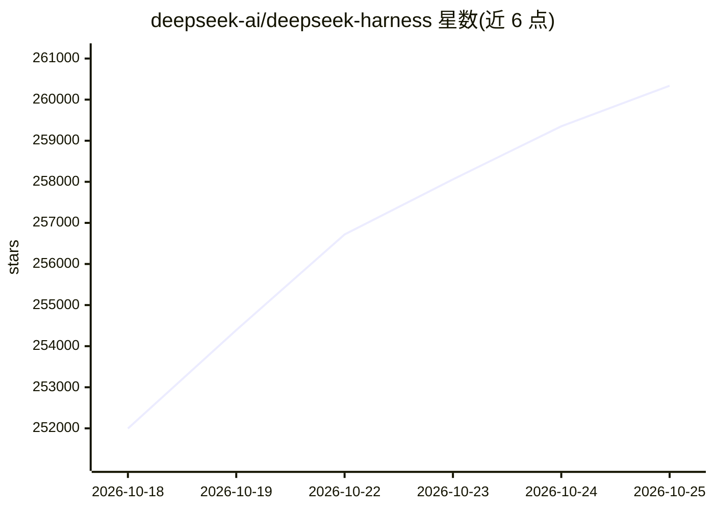

# deepseek-ai/deepseek-harness

⭐ 261,315 · TypeScript · MIT · 推送 2026-10-23 · [GitHub](https://github.com/deepseek-ai/deepseek-harness) · [官网](https://deepseek.com/harness) · 组织维护 · 中文 README

**DeepSeek 开源的 agent 运行时框架，一切皆插件**

由 DeepSeek AI 开发的开源 agent harness（dsh），基于 Cordis 框架的 everything-is-a-plugin 架构，设计思想出自一篇时空可组合性编程范式的论文。目前处于 developer preview 阶段，官方声明会有破坏性兼容变更。提供 Web UI（默认 127.0.0.1:3080）与 SSH 两种启动方式，支持通过 npm 直接运行或克隆仓库用 pnpm 从源码构建，插件仓库通过 dsh-plugin 话题标签收录。

## 筛选速览

| 维度 | 判定 | 备注 |
|---|---|---|
| AI 角色 | `ai-native` | 本体是模型或模型工具 |
| 许可风险 | `permissive` | MIT |
| 部署形态 | `library` | 以包/库形式分发 |
| 模型依赖 | locked-api |  |
| 硬件要求 | — | 无带数字的原话,不猜 |
| 安装摩擦 | `low` | 无编译、无系统依赖或容器化 |
| 成熟度 | `idea` | |

## 动量与使用信号

- 维护:`active` — 距上次 push 1.0 天,年发版 31,44 位贡献者
- 涨星:近 1 天 **+1,193**(自 20261016 起算)
- 安装:npm 包 `@deepseek-ai/dsh` 月下载 1,723,718
- 平台:WEB · 协议:—

## 能力要点

- everything-is-a-plugin 架构，基于 Cordis 框架
- npm 一条命令启动本地 Web UI（127.0.0.1:3080）
- 支持 SSH 场景启动与 --no-open 无浏览器运行
- 插件仓库可通过 dsh-plugin topic 提升可发现性

## 适用场景

- 本地启动 agent harness 的 Web 界面进行交互
- 基于插件机制开发自定义 agent 扩展
- 通过 SSH 远程环境运行并转发访问

## 场景标签

`Agent 框架` · 领域:Agent 开发

## 证据(README 行号)

> L5: DeepSeek Harness (`dsh`) is an open-source agent harness developed by DeepSeek AI.
> L7: It is built on an **everything-is-a-plugin** architecture and powered by Cordis, whose design is described in _A Pro
> L11: ## Developer preview

## 星数曲线

2026-10-18 251,995 → 2026-10-25 260,339（+8,344）

---
*卡片 v1 · prompt 1.4 · 生成 2026-10-18 · 置信度 high · 依据 README sha `50f2faa256f5` · [字段定义](../../DATASET.md)*
