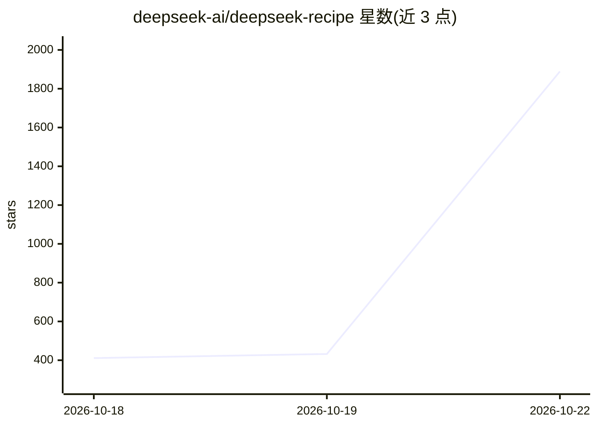

# deepseek-ai/deepseek-recipe

⭐ 2,131 · Rust · MIT · 推送 2026-10-19 · [GitHub](https://github.com/deepseek-ai/deepseek-recipe) · 组织维护 · 中文 README

**Rust 库+Python 绑定：把多格式 API 请求转换为 DeepSeek 提示与词元**

由 DeepSeek 维护的协议转换库集合：将 Messages、Chat Completions、Responses 三种格式的请求统一转换为 Conversation 格式，渲染 DeepSeek V4/V4.1 对话为提示词，并可通过附加 tokenizer 将对话编码为 token ID、解析模型输出回对应格式的响应（含流式、思维链、工具调用、JSON Schema/regex 结构化输出、图像预处理）。调用方需自行提供模型推理、工具执行与 HTTP 传输。提供 Python 3.10+ 包、Rust crate、本地 Web 演示与 Axum/FastAPI mock 示例服务。

## 筛选速览

| 维度 | 判定 | 备注 |
|---|---|---|
| AI 角色 | `ai-ecosystem` | LLM/agent 周边工具 |
| 许可风险 | `permissive` | MIT |
| 部署形态 | `library` | 以包/库形式分发 |
| 模型依赖 | locked-api |  |
| 硬件要求 | — | 无带数字的原话,不猜 |
| 安装摩擦 | `low` | 无编译、无系统依赖或容器化 |
| 成熟度 | — | 结构信号不足 |

## 能力要点

- Messages / Chat Completions / Responses 三种协议的请求与响应转换
- DeepSeek V4 与 V4.1 提示词渲染与 token 编码（附加 tokenizer）
- 支持流式响应、思维链、工具调用与 json_schema/regex 结构化输出
- 提供 encoding-decoding-demo Web 界面与 Rust/Python mock 服务示例

## 适用场景

- 为自建推理后端实现兼容多协议的 API 服务
- 将 DeepSeek V4/V4.1 请求渲染为提示词并编码为 token ID
- 调试和查看提示词渲染与特殊 token 高亮

## 场景标签

 · 领域:LLM 基础设施/推理服务

## 证据(README 行号)

> L7: deepseek-recipe is a collection of Rust libraries and Python bindings that
> L11: output into responses in the corresponding format. Use these components to
> L12: connect an inference backend to API services that support multiple formats. The

## 星数曲线

2026-10-18 411 → 2026-10-22 1,889（+1,478）

---
*卡片 v1 · prompt 1.4 · 生成 2026-10-21 · 置信度 high · 依据 README sha `0688f68e5b32` · [字段定义](../../DATASET.md)*
