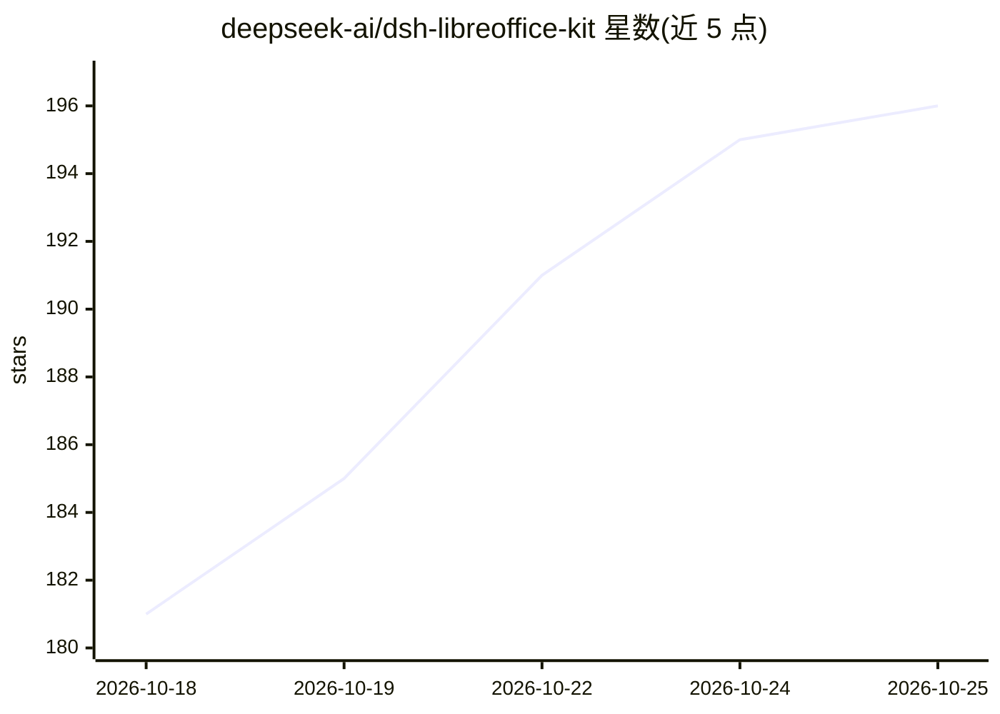

# deepseek-ai/dsh-libreoffice-kit

⭐ 199 · JavaScript · MPL-2.0 · 推送 2026-09-30 · [GitHub](https://github.com/deepseek-ai/dsh-libreoffice-kit) · [官网](https://deepseek.com/harness/) · 组织维护 · 中文 README

**给 Node.js 开发者的 Office→PDF/PNG 转换库（预编译 LibreOffice 引擎）**

由 deepseek-ai 维护、供 DeepSeek Harness 内部使用的 Node.js 包，基于裁剪并预编译的 LibreOffice 引擎做 Office 文档转换：OOXML 与二进制 Office 97–2003（.doc/.xls/.ppt）导出 PDF，可直接将 Office/PDF 渲染为 PNG，支持电子表格重算与 CLI（dsoffice）。重点在字体控制：可配置字体目录、字体替换组、missingFonts 报告与字体预算。分发为 macOS/Windows 原生包与 Linux WASM 引擎，npm 安装无需自行编译。限制：不保证与 Microsoft Office 输出一致，字体需部署方自备，.wps 及改名的 RTF/HTML 不接受。

## 筛选速览

| 维度 | 判定 | 备注 |
|---|---|---|
| AI 角色 | `ai-ecosystem` | LLM/agent 周边工具 |
| 许可风险 | `permissive` | MPL-2.0 |
| 部署形态 | `library` | 以包/库形式分发 |
| 模型依赖 | locked-api |  |
| 硬件要求 | — | 无带数字的原话,不猜 |
| 安装摩擦 | `low` | 无编译、无系统依赖或容器化 |
| 成熟度 | — | 结构信号不足 |

## 能力要点

- 预编译 LibreOffice 引擎（macOS/Windows 原生、Linux WASM），npm 安装无需编译
- Office→PDF 转换、PNG 直接渲染、电子表格重算，附 dsoffice CLI
- 字体目录/替换组/missingFonts 报告/字体数量与字节预算等显式字体控制
- 每次渲染使用独立进程或 Worker 与私有 profile，同转换器上渲染串行化

## 适用场景

- Node.js 服务中把 Word/Excel/PowerPoint 文档转为 PDF
- 文档处理任务中将文档页渲染为 PNG 图片
- 需要对中英文字体替换做显式控制的文档转换流水线
- 在离线/容器环境中打包运行文档转换引擎

## 场景标签

`文档解析` · 领域:知识与检索

## 证据(README 行号)

> L1: description: "Font-friendly Office-to-PDF conversion in Node.js, with prebuilt LibreOffice engines."
> L13: The API supports Office export and recalculation plus direct PNG rendering of Office and PDF inputs. Use it in a No
> L19: Requires Node.js **22.19.0 or newer**. Install the `0.1.3` package with its optional engines:

## 星数曲线

2026-10-18 181 → 2026-10-25 196（+15）

---
*卡片 v1 · prompt 1.4 · 生成 2026-10-22 · 置信度 mid · 依据 README sha `19e40fca68a5` · [字段定义](../../DATASET.md)*
