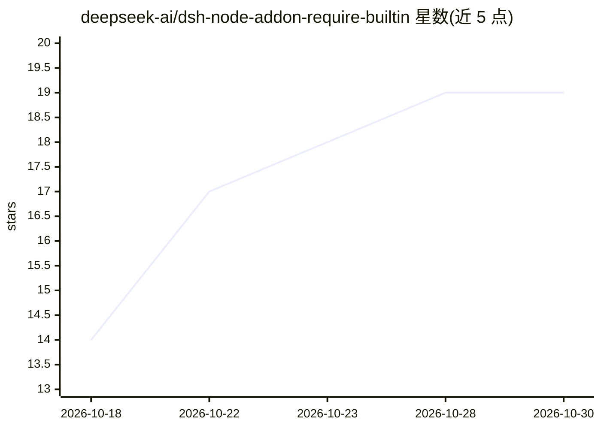

# deepseek-ai/dsh-node-addon-require-builtin

⭐ 19 · C++ · MIT · 推送 2026-10-12 · [GitHub](https://github.com/deepseek-ai/dsh-node-addon-require-builtin) · [官网](https://deepseek.com/harness/) · 组织维护 · 中文 README

**Node 原生扩展库：免 --expose-internals 获取 Node 内部 requireBuiltin**

deepseek-ai 维护、DeepSeek Harness 使用的内部组件：以 Node-API v9 稳定入口加载原生插件，在运行时探测 Node/V8 私有状态，从而调用 Node 内部 requireBuiltin()，无需以 --expose-internals 启动 Node。提供两个产品线：internal-loader（仅允许 CJS/ESM loader 内部模块，原生层强制白名单）与 require-builtin（不限制模块 id）。每个平台发布 napi-v9 预编译二进制（macOS/Linux/Windows，Node 20–26，另测 Electron 43–45）；无可兼容预编译时安装直接失败，不做本地编译回退。面向需要访问 Node 内部模块的开发者，npm 安装。

## 筛选速览

| 维度 | 判定 | 备注 |
|---|---|---|
| AI 角色 | `ai-ecosystem` | LLM/agent 周边工具 |
| 许可风险 | `permissive` | MIT |
| 部署形态 | `library` | 以包/库形式分发 |
| 模型依赖 | — | README 未给出锁定关系 |
| 硬件要求 | — | 无带数字的原话,不猜 |
| 安装摩擦 | `low` | 无编译、无系统依赖或容器化 |
| 成熟度 | — | 结构信号不足 |

## 能力要点

- 两个产品线：白名单版 internal-loader 与不受限版 require-builtin
- 通过 N-API v9 入口在运行时探测 Node/V8 私有状态
- 8 类平台预编译二进制，覆盖 Node 20/22/24/26 与 Electron 43–45
- 无可兼容预编译时安装 fail closed，不编译未验证的本地二进制

## 适用场景

- 在不使用 --expose-internals 的情况下加载 Node 内部模块
- 访问 CJS/ESM loader 内部实现（如 getOrInitializeCascadedLoader）
- 跨 macOS/Linux/Windows 的 Node 与 Electron 主进程中做内部模块诊断

## 场景标签

 · 领域:开发者工具/Node.js 原生扩展

## 证据(README 行号)

> L1: # Node addon internal require
> L5: Node-API addons that obtain Node's internal `requireBuiltin()` without starting

## 星数曲线

2026-10-18 14 → 2026-10-30 19（+5）

---
*卡片 v1 · prompt 1.4 · 生成 2026-10-28 · 置信度 low · 依据 README sha `a390440b816c` · [字段定义](../../DATASET.md)*
