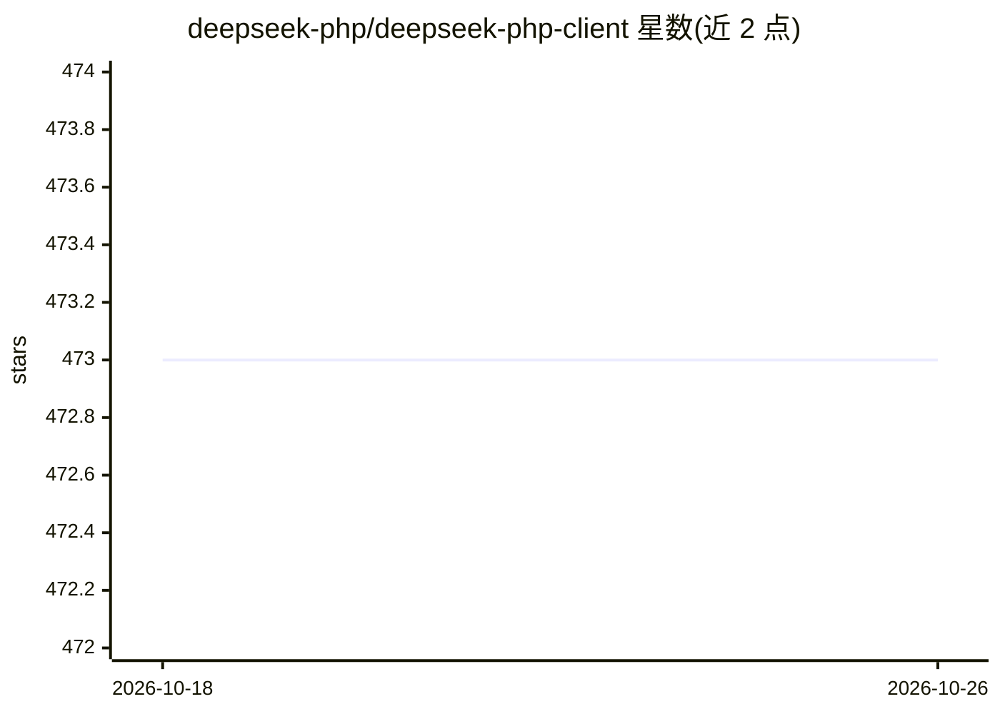

# deepseek-php/deepseek-php-client

⭐ 473 · PHP · MIT · 推送 2026-05-24 · [GitHub](https://github.com/deepseek-php/deepseek-php-client) · 组织维护 · 中文 README

**PHP 应用的 DeepSeek API 客户端 SDK**

社区维护的开源 PHP SDK，封装 DeepSeek API 访问：流式构建器模式的链式请求构造、PSR-18 合规 HTTP 客户端集成（默认 Guzzle，可选 Symfony HttpClient）、支持 deepseek-v4-pro 与 deepseek-v4-flash 模型、JSON 响应格式、Function Calling 与模型列表查询。要求 PHP 8.1+，通过 Composer 安装，另有 Laravel/Symfony 框架集成包。旧模型常量（CHAT/CODER/R1 等）计划在 v3.0.0 移除。

## 筛选速览

| 维度 | 判定 | 备注 |
|---|---|---|
| AI 角色 | `ai-ecosystem` | LLM/agent 周边工具 |
| 许可风险 | `permissive` | MIT |
| 部署形态 | `None` |  |
| 模型依赖 | locked-api |  |
| 硬件要求 | — | 无带数字的原话,不猜 |
| 安装摩擦 | `low` | 无编译、无系统依赖或容器化 |
| 成熟度 | — | 结构信号不足 |

## 能力要点

- 链式 Builder 模式构造 DeepSeek API 请求
- 支持 deepseek-v4-pro / v4-flash 模型与流式响应
- Guzzle 默认、Symfony HttpClient 可选的 PSR-18 HTTP 客户端层
- 提供 JSON Mode、Function Calling 与 Laravel/Symfony 集成

## 适用场景

- PHP 项目中接入 DeepSeek 对话/推理 API
- Laravel 或 Symfony 应用集成 DeepSeek 模型能力
- 构建基于 DeepSeek Function Calling 的工具调用应用

## 场景标签

 · 领域:LLM 基础设施/SDK

## 证据(README 行号)

> L2:  ⚡️ A community-driven, open-source PHP client for DeepSeek AI, officially listed in the DeepSeek API documentation 
> L26: - **Seamless API Integration**: PHP-first interface for DeepSeek's AI capabilities.

## 星数曲线

2026-10-18 473 → 2026-10-26 473（+0）

---
*卡片 v1 · prompt 1.4 · 生成 2026-10-21 · 置信度 high · 依据 README sha `18a5465b6046` · [字段定义](../../DATASET.md)*
