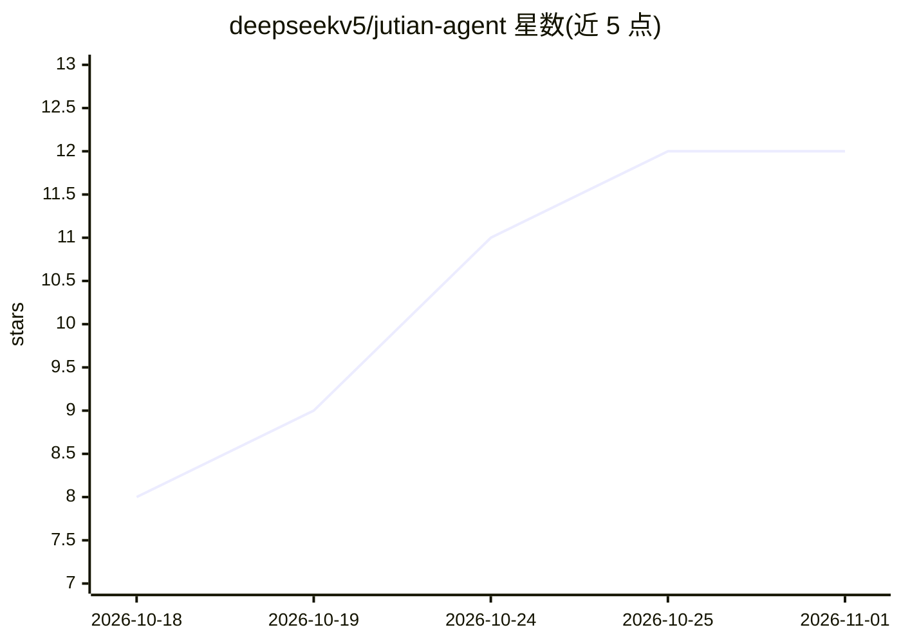

# deepseekv5/jutian-agent

⭐ 12 · TypeScript · NOASSERTION · 推送 2026-10-31 · [GitHub](https://github.com/deepseekv5/jutian-agent) · [官网](https://deepseekv5.github.io/jutian-agent/) · 组织维护 · 中文 README

**本地优先的开源 AI 桌面工作台：对话执行任务、代码、集群**

基于 Electron 的桌面 AI 工作台，面向终端用户：50 个内置工具直连终端与文件系统执行任务；内置代码编辑器与终端（每轮对话自动快照、一键撤销）；支持多代理集群（总管拆任务、员工@接力）与 1–5 个并行子代理；内置免费模型面板（OpenRouter 免费档聚合路由，免 key，限每 IP 200 次/小时），也可配置任意 OpenAI 兼容服务；支持 MCP 接入、Skills 技能市场、RAG 知识库与长期记忆；提供手机远程（局域网扫码）与安卓本地版 APK。数据存储于本地 ~/.lyclaw/ 目录。

## 筛选速览

| 维度 | 判定 | 备注 |
|---|---|---|
| AI 角色 | `ai-native` | 本体是模型或模型工具 |
| 许可风险 | `permissive` | NOASSERTION |
| 部署形态 | `desktop` | 安装包/桌面程序 |
| 模型依赖 | locked-api |  |
| 硬件要求 | — | 无带数字的原话,不猜 |
| 安装摩擦 | `low` | 无编译、无系统依赖或容器化 |
| 成熟度 | — | 结构信号不足 |

## 能力要点

- 50 个内置工具直连终端与文件系统执行任务
- 多代理集群与 1–5 个并行子代理（并发 3）
- 免费模型面板：OpenRouter 免费档免 key 一键切换（每 IP 200 次/小时）
- 手机远程扫码配对与安卓本地版（单 APK 内含 Node 运行时）

## 适用场景

- 用对话驱动 AI 在本机执行文件、终端与代码任务
- 通过子代理集群并行完成调研、开发、审校等多步工作
- 离线/本地数据优先地使用 AI 工作台与知识库检索
- 手机远程指挥电脑上的 Agent 干活

## 场景标签

`多智能体` `RAG` `AI 助手` · 领域:Agent 开发

## 证据(README 行号)

> L37: 50 个内置工具直连真实终端与文件系统。你说目标,它拆步骤、调工具、验证、给结果。不是建议,是执行。
> L75: 内置**免费模型面板**:默认 OpenRouter Free Models Router(`openrouter/free`,聚合 20+ 免费模型自动路由),共 21 个免费档免 key 一键切换,不注册、不付费、每 IP 2

## 星数曲线

2026-10-18 8 → 2026-11-01 12（+4）

---
*卡片 v1 · prompt 1.4 · 生成 2026-11-01 · 置信度 high · 依据 README sha `8b81f4d6505f` · [字段定义](../../DATASET.md)*
