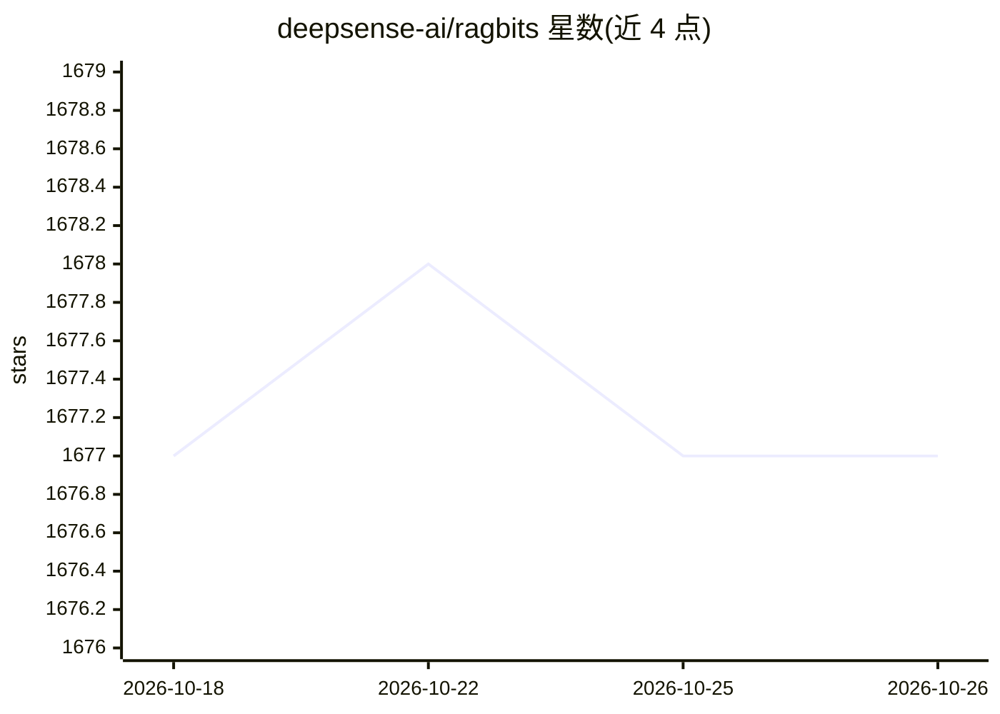

# deepsense-ai/ragbits

⭐ 1,677 · Python · MIT · 推送 2026-05-18 · [GitHub](https://github.com/deepsense-ai/ragbits) · [官网](https://ragbits.deepsense.ai) · 组织维护

**面向开发者的 GenAI 应用构建模块库（LLM/RAG/Agent/评测）**

由 deepsense.ai 维护的 Python 框架，提供构建 GenAI 应用的模块化组件：通过 LiteLLM 接入 100+ LLM 或本地模型、类型安全的 LLM 调用、内置 Qdrant/PgVector 等向量库支持；文档处理支持 20+ 格式（Docling/Unstructured）与 Ray 并行摄取；多 Agent 协作支持 A2A 协议与 MCP；另含评测框架、guardrails、CLI 与可部署的 Chat UI。以 pip 安装的捆绑包形式分发，也可单独安装各子包。

## 筛选速览

| 维度 | 判定 | 备注 |
|---|---|---|
| AI 角色 | `ai-ecosystem` | LLM/agent 周边工具 |
| 许可风险 | `permissive` | MIT |
| 部署形态 | `library` | 以包/库形式分发 |
| 模型依赖 | — | README 未给出锁定关系 |
| 硬件要求 | — | 无带数字的原话,不猜 |
| 安装摩擦 | `low` | 无编译、无系统依赖或容器化 |
| 成熟度 | — | 结构信号不足 |

## 能力要点

- 经 LiteLLM 切换 100+ LLM 或运行本地模型
- 20+ 文档格式摄取与 Ray 并行处理
- A2A 协议多 Agent 协作与 MCP 实时数据接入
- 评测框架、guardrails、CLI 与 Chat UI 组件

## 适用场景

- 快速搭建 RAG 或 Agentic RAG 流水线
- 构建带评测与可观测性的 LLM 应用
- 从模板创建 GenAI 项目并部署对话界面

## 场景标签

`RAG` `多智能体` `模型评测` `提示工程` · 领域:Agent 开发

## 证据(README 行号)

> L17: - **Swap LLMs anytime** – Switch between 100+ LLMs via LiteLLM or run local models.
> L67: - `ragbits-core` - fundamental tools for working with prompts, LLMs and vector databases.
> L70: - `ragbits-evaluate` - unified evaluation framework for Ragbits components.

## 星数曲线

2026-10-18 1,677 → 2026-10-26 1,677（+0）

---
*卡片 v1 · prompt 1.4 · 生成 2026-10-21 · 置信度 high · 依据 README sha `694fdee997c1` · [字段定义](../../DATASET.md)*
