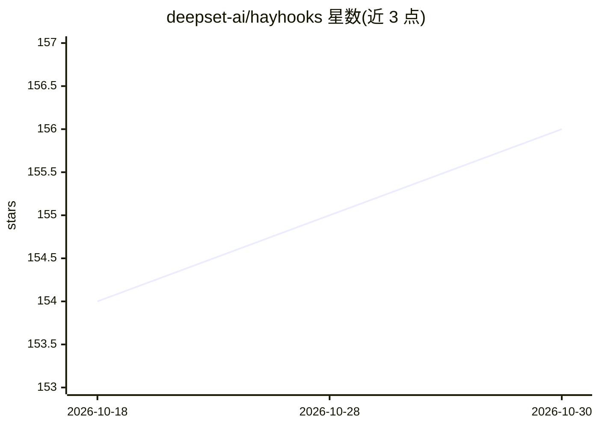

# deepset-ai/hayhooks

⭐ 156 · Python · Apache-2.0 · 推送 2026-10-26 · [GitHub](https://github.com/deepset-ai/hayhooks) · [官网](https://deepset-ai.github.io/hayhooks/) · 组织维护

**将 Haystack 管道与 agent 部署为 REST/OpenAI 兼容/MCP/A2A 服务**

deepset 维护的 Haystack 管线服务化工具：开发者编写 Python wrapper 或 YAML 管线，即可暴露为带类型校验与 OpenAPI 文档的 REST 端点、OpenAI 兼容的流式 Chat Completions/Responses API、MCP 工具（供 Cursor、Claude Desktop 等客户端调用）及 A2A agent。支持基于 Redis 的持久化执行（检查点、人工审批、重启恢复）与终端仪表盘/OTel 追踪。需 Python 3.10–3.14，快速开始需 OpenAI API key；持久化模式需 Redis 与 durable 附加组件。

## 筛选速览

| 维度 | 判定 | 备注 |
|---|---|---|
| AI 角色 | `ai-ecosystem` | LLM/agent 周边工具 |
| 许可风险 | `permissive` | Apache-2.0 |
| 部署形态 | `self-host` | docker 或自建部署 |
| 模型依赖 | — | README 未给出锁定关系 |
| 硬件要求 | — | 无带数字的原话,不猜 |
| 安装摩擦 | `low` | 无编译、无系统依赖或容器化 |
| 成熟度 | — | 结构信号不足 |

## 能力要点

- Python wrapper 经类型提示生成 API schema 的 REST 端点
- OpenAI 兼容流式聊天 API，可接 Open WebUI 或内嵌 Chainlit UI
- MCP server 将管线/agent 暴露为工具
- Redis 检查点的持久化执行：人工审批、失败重试、重启恢复

## 适用场景

- 把 Haystack 管线或 agent 快速发布为可调用 API
- 让 Cursor/Claude Desktop 等 MCP 客户端调用自家管线
- 长任务暂停等待人工审批后继续执行

## 场景标签

`Agent 框架` · 领域:Agent 开发

## 证据(README 行号)

> L3: **Serve Haystack pipelines and agents as APIs.**
> L16: Write a Python wrapper around your pipeline or agent. Choose the interfaces and runtime features you need:
> L18: - **REST APIs.** Deploy Python wrappers or YAML pipelines as typed, validated endpoints with OpenAPI docs, file upl

## 星数曲线

2026-10-18 154 → 2026-10-30 156（+2）

---
*卡片 v1 · prompt 1.4 · 生成 2026-10-22 · 置信度 mid · 依据 README sha `d34e370561ee` · [字段定义](../../DATASET.md)*
