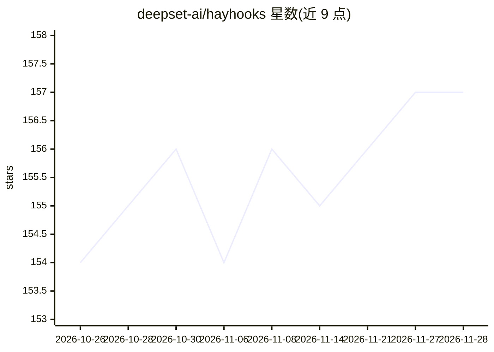

# deepset-ai/hayhooks

⭐ 157 · Python · Apache-2.0 · 推送 2026-11-27 · [GitHub](https://github.com/deepset-ai/hayhooks) · [官网](https://deepset-ai.github.io/hayhooks/) · 组织维护

**将 Haystack pipeline 与 agent 部署为 REST API 与 MCP 工具**

为 Haystack pipeline 和 agent 提供服务化部署的运行时：用 Python wrapper 包装后可发布为带 OpenAPI 文档的 REST 端点、OpenAI 兼容的流式 Chat Completions 接口、MCP 工具，以及支持 A2A 协议的 agent。提供 Redis 持久化执行（检查点、人工审批、故障恢复）、终端仪表盘查看执行与组件追踪，并可导出 OpenTelemetry span。要求 Python 3.10–3.14，需配置模型 API key；由 deepset 团队维护。

## 筛选速览

| 维度 | 判定 | 备注 |
|---|---|---|
| AI 角色 | `ai-ecosystem` | LLM/agent 周边工具 |
| 许可风险 | `permissive` | Apache-2.0 |
| 部署形态 | `self-host` | docker 或自建部署 |
| 模型依赖 | — | README 未给出锁定关系 |
| 硬件要求 | — | 无带数字的原话,不猜 |
| 安装摩擦 | `low` | 无编译、无系统依赖或容器化 |
| 成熟度 | — | 结构信号不足 |

## 能力要点

- 一个 wrapper 可同时暴露为 REST API、OpenAI 兼容接口、MCP 工具与 A2A agent
- Redis 检查点支持长任务持久化、人工审批与重启恢复
- 终端仪表盘查看部署、执行与慢组件，追踪可导出到 OpenTelemetry
- Durable 引擎可嵌入任意 FastAPI 应用

## 适用场景

- 把本地调试好的 Haystack agent 发布成团队可调用的 REST 服务
- 把 pipeline 暴露为 MCP 工具供 Cursor 等客户端调用
- 需要人工审批环节和断点恢复的长时 agent 任务

## 场景标签

 · 领域:LLM 基础设施/模型部署

## 证据(README 行号)

> L3: **Serve Haystack pipelines and agents as APIs.**
> L5: REST APIs, OpenAI-compatible chat, MCP tools, and A2A agents, with durable execution and built-in tracing.
> L204: Hayhooks is actively maintained by the deepset team.

## 星数曲线

2026-10-26 154 → 2026-11-28 157（+3）

---
*卡片 v1 · prompt 1.4 · 生成 2026-11-28 · 置信度 mid · 依据 README sha `a2cfeb854454` · [字段定义](../../DATASET.md)*
