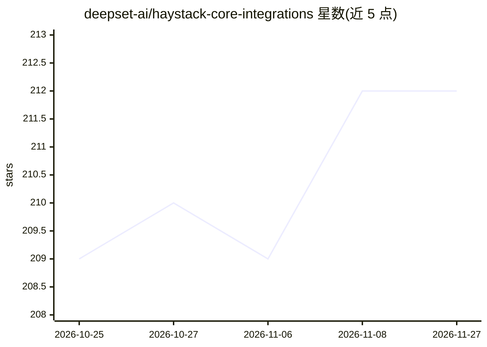

# deepset-ai/haystack-core-integrations

⭐ 212 · Python · Apache-2.0 · 推送 2026-11-26 · [GitHub](https://github.com/deepset-ai/haystack-core-integrations) · [官网](https://haystack.deepset.ai) · 组织维护

**为 Haystack 框架扩展组件与文档存储的集成包集合**

由 deepset 维护的仓库，收录扩展 Haystack 能力的集成包，类型涵盖 Generator、Embedder、Document Store、Converter、Ranker、Tracer、Tool、Web Search 等；每个集成为独立自包含的包，附带各自的 README 说明安装、用法与支持方式。仓库提供基于 hatch 的开发环境：进入对应集成目录后用 hatch 运行测试套件，由 hatch 建立隔离的 Python 环境；并给出各包在 PyPI 的版本、测试状态与覆盖率清单。

## 筛选速览

| 维度 | 判定 | 备注 |
|---|---|---|
| AI 角色 | `ai-ecosystem` | LLM/agent 周边工具 |
| 许可风险 | `permissive` | Apache-2.0 |
| 部署形态 | `library` | 以包/库形式分发 |
| 模型依赖 | local-ok | 支持本地模型 |
| 硬件要求 | — | 无带数字的原话,不猜 |
| 安装摩擦 | `low` | 无编译、无系统依赖或容器化 |
| 成熟度 | — | 结构信号不足 |

## 能力要点

- 收录数十个集成包，覆盖文档存储、模型生成器、嵌入器、转换器等类型
- 每个集成为自包含包，独立维护并各有专属 README
- 提供 hatch 驱动的隔离 Python 环境与测试套件运行方式
- 清单标注各包的 PyPI 版本、测试状态与单元/组合覆盖率

## 适用场景

- 为 Haystack 管道接入特定文档存储（如 Chroma、Elasticsearch、Pinecone）
- 为 Haystack 接入不同模型服务商的生成与嵌入组件
- 参与集成包开发并运行其测试套件

## 场景标签

`RAG` · 领域:知识与检索

## 证据(README 行号)

> L3: This repository contains integrations to extend the capabilities of Haystack. The code in this repo is maintained by
> L28: |agent-pack-haystack|Agents|PyPI - Version|Test / agent_pack|Coverage badge|Coverage badge|

## 星数曲线

2026-10-25 209 → 2026-11-27 212（+3）

---
*卡片 v1 · prompt 1.4 · 生成 2026-11-25 · 置信度 mid · 依据 README sha `97f8169f6d3d` · [字段定义](../../DATASET.md)*
