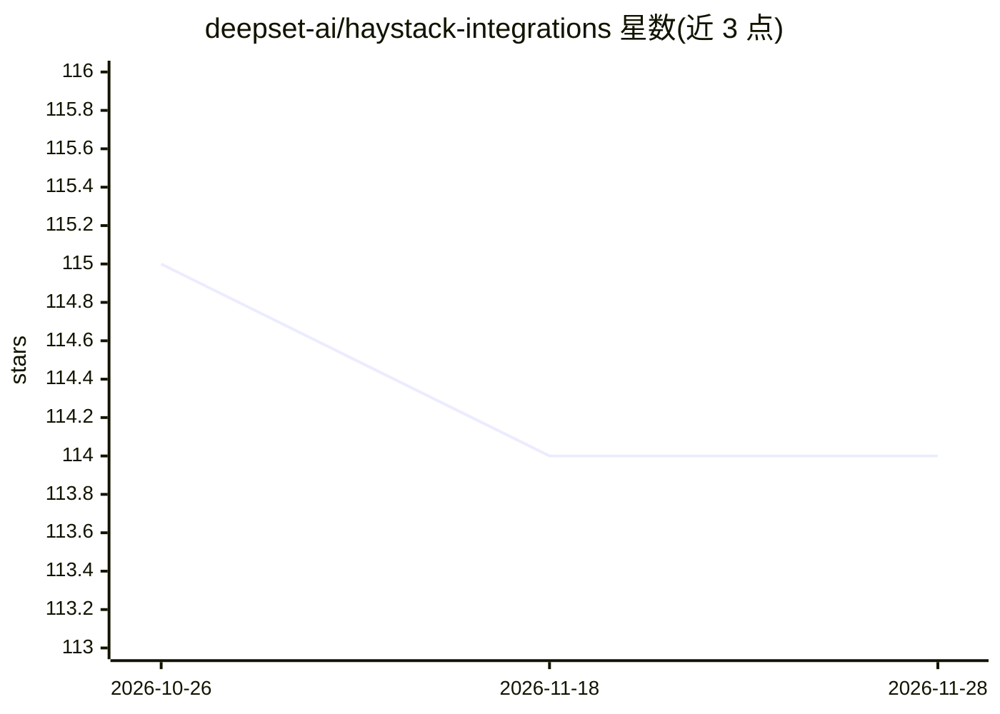

# deepset-ai/haystack-integrations

⭐ 114 · Python · 推送 2026-11-27 · [GitHub](https://github.com/deepset-ai/haystack-integrations) · [官网](https://haystack.deepset.ai/integrations) · 组织维护

**Haystack 集成组件的社区维护索引清单**

该仓库是 Haystack 集成的索引目录，收录可配合 Haystack Pipeline 或 Agent 使用的模型提供方、文档存储、数据摄取、监控工具、自定义组件、评测框架等集成，集成以外部包或附加技术形式存在，由 deepset 团队或社区作者分别维护。用户在 Haystack 集成页面浏览各集成的作者、安装与用法；贡献者通过提交 integration issue 讨论、经维护者标记 approved 后以 PR 添加 integrations/ 目录下的 .md 条目，条目须含 pypi 或 repo 字段之一。

## 筛选速览

| 维度 | 判定 | 备注 |
|---|---|---|
| AI 角色 | `ai-knowledge` | 知识聚合/清单类 |
| 许可风险 | `none` | — |
| 部署形态 | `library` | 以包/库形式分发 |
| 模型依赖 | — | README 未给出锁定关系 |
| 硬件要求 | — | 无带数字的原话,不猜 |
| 安装摩擦 | `low` | 无编译、无系统依赖或容器化 |
| 成熟度 | — | 结构信号不足 |

## 能力要点

- 索引模型提供方、文档存储、监控、评测框架等多类 Haystack 集成
- 集成由各自作者或 deepset 团队维护
- 提供 issue 讨论加 PR 提交的集成收录流程
- 集成条目须至少包含 pypi 或 repo 字段之一

## 适用场景

- 为 Haystack 管道查找可用的模型提供方或文档存储集成
- 把自己开发的 Haystack 组件提交进生态目录
- 浏览各集成的作者、安装与用法信息

## 场景标签

`精选清单` · 领域:学习与行业

## 证据(README 行号)

> L3: This repository is an index of Haystack integrations that can be used with a Haystack Pipeline or Agent.
> L9: Haystack Integrations are a Model Provider, Document Store, Data Ingestion, Monitoring Tool, Custom Component, Evalu

## 星数曲线

2026-10-26 115 → 2026-11-28 114（-1）

---
*卡片 v1 · prompt 1.4 · 生成 2026-11-28 · 置信度 mid · 依据 README sha `53b92aecfe85` · [字段定义](../../DATASET.md)*
