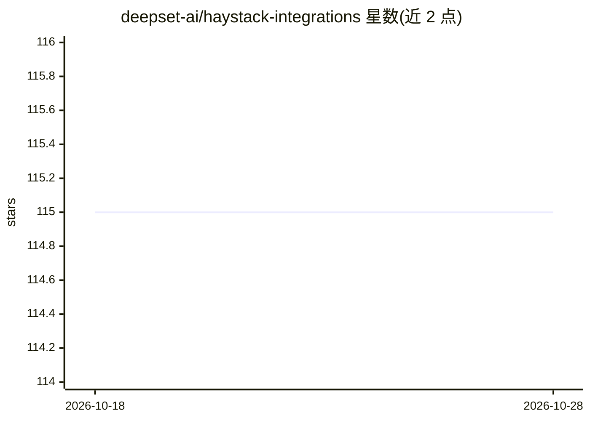

# deepset-ai/haystack-integrations

⭐ 115 · Python · 推送 2026-10-28 · [GitHub](https://github.com/deepset-ai/haystack-integrations) · [官网](https://haystack.deepset.ai/integrations) · 组织维护

**Haystack 框架社区集成的官方索引仓库**

deepset 维护的 Haystack 集成条目索引：收录社区或 deepset 团队维护的 Document Store、Model Provider、自定义组件、监控工具与评测框架等集成，条目以 integrations/ 目录下的 .md 文件形式组织，浏览入口为 Haystack Integrations 页面。贡献流程为创建 PR 添加 .md 文件，frontmatter 需含 name 等字段，且 pypi 或 repo 字段至少一项，通过审核后在集成页面上线。

## 筛选速览

| 维度 | 判定 | 备注 |
|---|---|---|
| AI 角色 | `ai-knowledge` | 知识聚合/清单类 |
| 许可风险 | `none` | — |
| 部署形态 | `library` | 以包/库形式分发 |
| 模型依赖 | — | README 未给出锁定关系 |
| 硬件要求 | — | 无带数字的原话,不猜 |
| 安装摩擦 | `low` | 无编译、无系统依赖或容器化 |
| 成熟度 | — | 结构信号不足 |

## 能力要点

- 索引 Haystack 的 Document Store、Model Provider、组件、监控与评测类集成
- 条目以 integrations/ 目录下带 frontmatter 的 .md 文件形式贡献
- 维护方包含 deepset 团队与社区作者两类

## 适用场景

- 为 Haystack Pipeline 或 Agent 查找可用的外部集成
- 开发者按模板提交自己的集成条目
- 了解 Haystack 生态集成的类型与来源

## 场景标签

`精选清单` · 领域:学习与行业

## 证据(README 行号)

> L3: This repository is an index of Haystack integrations that can be used with a Haystack Pipeline or Agent.
> L9: Haystack Integrations are a Document Store, Model Provider, Custom Component, Monitoring Tool or Evaluation Framewor

## 星数曲线

2026-10-18 115 → 2026-10-28 115（+0）

---
*卡片 v1 · prompt 1.4 · 生成 2026-10-23 · 置信度 mid · 依据 README sha `c148f53d0940` · [字段定义](../../DATASET.md)*
