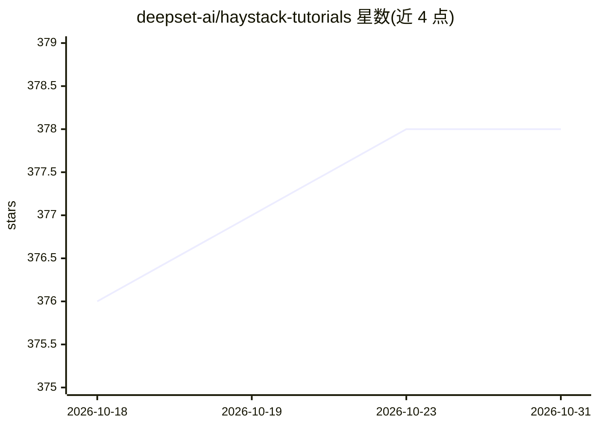

# deepset-ai/haystack-tutorials

⭐ 378 · Jupyter Notebook · Apache-2.0 · 推送 2026-10-27 · [GitHub](https://github.com/deepset-ai/haystack-tutorials) · [官网](https://haystack.deepset.ai/tutorials) · 组织维护

**Haystack 框架官方教程仓库：RAG 与 Agent 管道示例**

deepset 维护的 Haystack 教程集合，教程同步发布到 Haystack 官网。内容覆盖检索增强问答管道、结构化输出生成、混合检索、RAG 管道评测、函数调用聊天应用、工具调用 Agent 与多 Agent 系统等，均以代码加 Colab 笔记本形式提供，并设有每晚运行教程的 CI 流程。面向使用 Haystack 框架构建 NLP/LLM 应用的开发者，支持通过贡献指南提交新教程。

## 筛选速览

| 维度 | 判定 | 备注 |
|---|---|---|
| AI 角色 | `ai-knowledge` | 知识聚合/清单类 |
| 许可风险 | `permissive` | Apache-2.0 |
| 部署形态 | `None` |  |
| 模型依赖 | — | README 未给出锁定关系 |
| 硬件要求 | — | 无带数字的原话,不猜 |
| 安装摩擦 | `low` | 无编译、无系统依赖或容器化 |
| 成熟度 | — | 结构信号不足 |

## 能力要点

- 覆盖 RAG 管道、评测、函数调用、工具调用 Agent 与多 Agent 系统等主题
- 每个教程提供代码与 Colab 笔记本
- 教程每晚自动运行（Run Tutorials Nightly）

## 适用场景

- 按教程学习用 Haystack 搭建 RAG 问答管道
- 参考混合检索、管道评测与 Agent 构建示例
- 通过贡献指南提交自己的教程

## 场景标签

`教程课程` · 领域:学习与行业

## 证据(README 行号)

> L5: This is the repository where we keep all the Haystack tutorials 📓 👇 These tutorials are also published to the Haysta
> L12: ## Tutorials

## 星数曲线

2026-10-18 376 → 2026-10-31 378（+2）

---
*卡片 v1 · prompt 1.4 · 生成 2026-10-21 · 置信度 high · 依据 README sha `abc5b61e19c3` · [字段定义](../../DATASET.md)*
