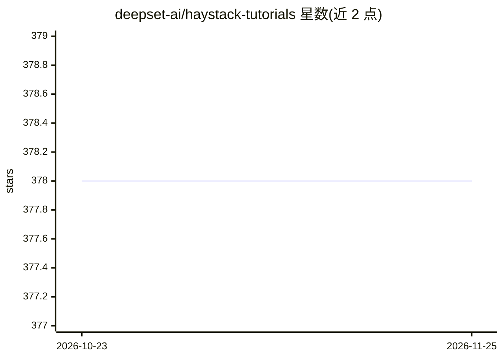

# deepset-ai/haystack-tutorials

⭐ 378 · Jupyter Notebook · Apache-2.0 · 推送 2026-11-16 · [GitHub](https://github.com/deepset-ai/haystack-tutorials) · [官网](https://haystack.deepset.ai/tutorials) · 组织维护

**Haystack 框架的官方教程集合仓库**

deepset 维护的 Haystack 框架配套教程仓库，收录全部官方教程的 notebook 代码，并同步发布到 Haystack 官网。内容以 Colab notebook 形式提供，覆盖 RAG 问答管线、结构化输出、混合检索、抽取式问答、RAG 评估、函数调用聊天应用、工具调用 Agent 与多 Agent 系统等主题，另附贡献指南供社区提交教程。

## 筛选速览

| 维度 | 判定 | 备注 |
|---|---|---|
| AI 角色 | `ai-knowledge` | 知识聚合/清单类 |
| 许可风险 | `permissive` | Apache-2.0 |
| 部署形态 | `None` |  |
| 模型依赖 | — | README 未给出锁定关系 |
| 硬件要求 | — | 无带数字的原话,不猜 |
| 安装摩擦 | `low` | 无编译、无系统依赖或容器化 |
| 成熟度 | — | 结构信号不足 |

## 能力要点

- 教程覆盖 RAG、评估、Agent、多 Agent 等主题
- 每个教程提供 Colab 一键打开入口
- 教程同步发布在 Haystack 官网
- 提供贡献指南接受社区教程提交

## 适用场景

- 按官方 notebook 上手 Haystack 构建 RAG 管线
- 学习如何评估和调试 RAG 系统
- 参考示例实现工具调用 Agent 与多 Agent 系统

## 场景标签

`教程课程` `RAG` `多智能体` · 领域:Agent 开发

## 证据(README 行号)

> L5: This is the repository where we keep all the Haystack tutorials 📓 👇 These tutorials are also published to the Haysta
> L12: ## Tutorials

## 星数曲线

2026-10-23 378 → 2026-11-25 378（+0）

---
*卡片 v1 · prompt 1.4 · 生成 2026-11-25 · 置信度 high · 依据 README sha `d3408a410933` · [字段定义](../../DATASET.md)*
