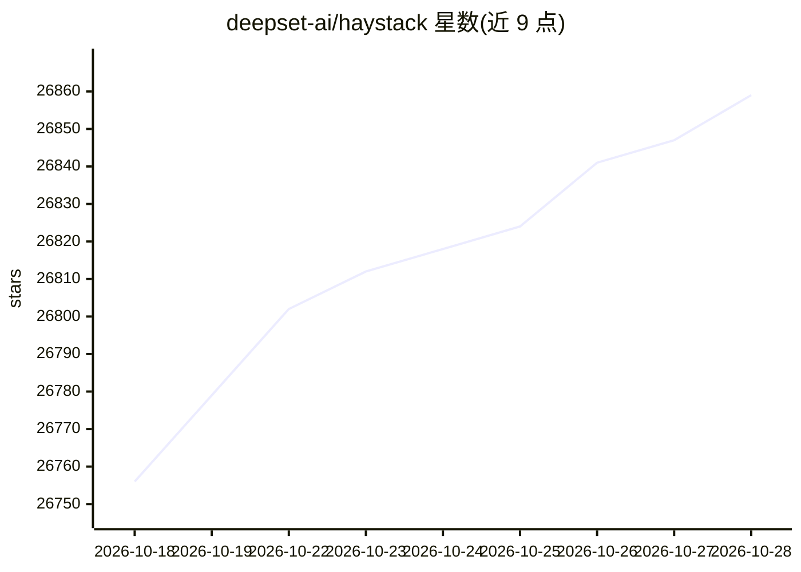

# deepset-ai/haystack

⭐ 26,859 · Python · Apache-2.0 · 推送 2026-10-27 · [GitHub](https://github.com/deepset-ai/haystack) · [官网](https://haystack.deepset.ai) · 组织维护

**面向 Python 开发者的 LLM 应用编排框架**

Haystack 是一个 Python 开源编排框架，用于构建生产级 LLM 应用。提供模块化 Pipeline 与 Agent 工作流，对检索、路由、记忆、生成环节做显式控制；同一 Pipeline 支持同步/异步运行与逐 token 流式输出，Agent 可并发调用工具并暴露生命周期钩子与 token/工具调用计数。模型与厂商无关，内置组件可自建扩展，可通过 pip 或 Docker 安装，另有 Hayhooks 将流水线封装为 REST API 或 MCP 服务。

## 筛选速览

| 维度 | 判定 | 备注 |
|---|---|---|
| AI 角色 | `ai-native` | 本体是模型或模型工具 |
| 许可风险 | `permissive` | Apache-2.0 |
| 部署形态 | `library` | 以包/库形式分发 |
| 模型依赖 | — | README 未给出锁定关系 |
| 硬件要求 | — | 无带数字的原话,不猜 |
| 安装摩擦 | `low` | 无编译、无系统依赖或容器化 |
| 成熟度 | — | 结构信号不足 |

## 动量与使用信号

- 维护:`active` — 距上次 push 1.2 天,年发版 57,447 位贡献者
- 涨星:近 1 天 **+10**(自 20261016 起算)
- 安装:pypi 包 `haystack-ai` 月下载 566,454
- 平台:— · 协议:OPENAI-API / MCP

## 能力要点

- 模块化 Pipeline 与 Agent 工作流，显式控制检索/路由/记忆/生成
- 同一 Pipeline 支持同步、异步与逐 token 流式输出，Agent 可并发工具调用
- 模型与厂商无关，可替换模型或基础设施组件
- 匿名组件级遥测，可按文档说明关闭

## 适用场景

- 构建带检索、排序、路由控制的 RAG 应用
- 搭建需要显式上下文控制的 agent 工作流
- 构建多模态应用与语义搜索/问答系统
- 通过 Hayhooks 把流水线部署为 REST API 或 MCP 服务

## 场景标签

`Agent 框架` `多智能体` `RAG` · 领域:Agent 开发

## 证据(README 行号)

> L10: Haystack is an open-source AI orchestration framework for building production-ready LLM applications in Python.
> L57: Integrate with OpenAI, Mistral, Anthropic, Cohere, Hugging Face, Google, Azure OpenAI, AWS Bedrock, local models, a

## 星数曲线

2026-10-18 26,756 → 2026-10-28 26,859（+103）

---
*卡片 v1 · prompt 1.4 · 生成 2026-10-18 · 置信度 high · 依据 README sha `cf5414c7cef5` · [字段定义](../../DATASET.md)*
