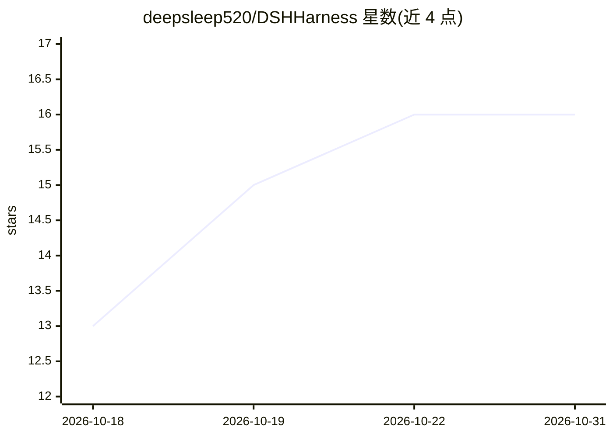

# deepsleep520/DSHHarness

⭐ 16 · NOASSERTION · 推送 2026-10-02 · [GitHub](https://github.com/deepsleep520/DSHHarness) · [官网](https://github.com/deepsleep520/DSHHarness/releases/latest) · 个人维护 · 中文 README

**安卓 App：PRoot 沙箱内跑 Alpine Linux 与 AI 编程助手 dsh**

面向安卓用户的 APK 应用：在应用私有目录用 PRoot 拉起 Alpine Linux 沙箱，运行 Node.js 与 DeepSeek 官方维护的 AI 编程助手 dsh（npm 包 @deepseek-ai/dsh），内置 WebView 显示其 Web 界面，无需 root/Termux/电脑。真机存储三入口直通并支持敏感目录只读保护；提供自动/无障碍/Root/Shizuku/基础五种控制档位，授权后 AI 可点按、输入、截屏操作手机本体；支持局域网访问与会话导出迁移。零数据收集、不内置 API Key。限制：仅 arm64、Android 8.0+、APK 约 184MB、自有代码不开源。

## 筛选速览

| 维度 | 判定 | 备注 |
|---|---|---|
| AI 角色 | `ai-native` | 本体是模型或模型工具 |
| 许可风险 | `none` | NOASSERTION |
| 部署形态 | `None` |  |
| 模型依赖 | locked-api |  |
| 硬件要求 | — | 无带数字的原话,不猜 |
| 安装摩擦 | `medium` | 含编译或系统依赖之一 |
| 成熟度 | `idea` | |

## 能力要点

- PRoot 沙箱内完整 Alpine Linux + Node.js 运行时，无需 root
- 五档控制通道，授权后 AI 可直接点按、输入、截屏操作手机
- 真机存储三入口直通，DCIM 等敏感目录可只读保护
- 零数据收集、不内置 API Key，会话可打包跨设备迁移

## 适用场景

- 在没有电脑的手机上使用 AI 编程助手和 Linux 命令行环境
- 让 AI 整理相册、批量改名、写脚本并当场运行
- 授权后让 AI 直接操作手机本体（点按、输入、截屏）
- 手机当便携开发机或局域网服务器，电脑浏览器访问

## 场景标签

`编码 Agent` `GUI 自动化` · 领域:效率与自动化

## 证据(README 行号)

> L30: DSH Harness 是一个安卓 App：它在应用私有目录里用 PRoot 拉起一个 **Alpine Linux 沙箱**，在沙箱里跑 Node.js 与 AI 编程助手 **dsh**（npm 包 `@deepseek-ai
> L41: - **让 AI 直接干活**：整理相册、批量改名、转换格式、抓取整理资料、写脚本并当场运行。

## 星数曲线

2026-10-18 13 → 2026-10-31 16（+3）

---
*卡片 v1 · prompt 1.4 · 生成 2026-10-30 · 置信度 high · 依据 README sha `8746e4390ff6` · [字段定义](../../DATASET.md)*
