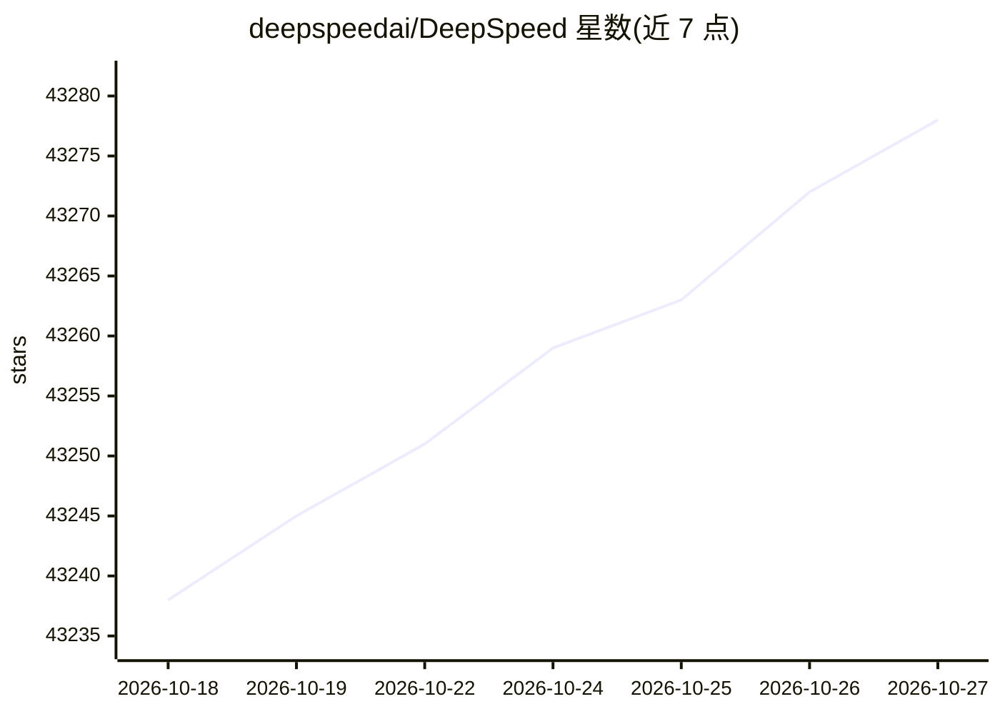

# deepspeedai/DeepSpeed

⭐ 43,278 · Python · Apache-2.0 · 推送 2026-10-26 · [GitHub](https://github.com/deepspeedai/DeepSpeed) · [官网](https://www.deepspeed.ai/) · 组织维护 · 中文 README

**大规模深度学习分布式训练与推理优化库**

微软开源的深度学习优化库，提供 ZeRO、ZeRO-Infinity、3D 并行、Ulysses 序列并行、MoE 等系统技术，用于训练与推理千亿至万亿参数模型；已集成 Transformers、Accelerate、Lightning 等框架。通过 pip 安装，默认以 JIT 方式编译 C++/CUDA 扩展，需先装 PyTorch 与 CUDA/ROCm 编译器；支持 NVIDIA/AMD GPU 及 Ascend NPU、Gaudi、XPU 等多种加速器，Windows 上部分功能不可用（如 AIO、GDS）。

## 筛选速览

| 维度 | 判定 | 备注 |
|---|---|---|
| AI 角色 | `ai-ecosystem` | LLM/agent 周边工具 |
| 许可风险 | `permissive` | Apache-2.0 |
| 部署形态 | `library` | 以包/库形式分发 |
| 模型依赖 | — | README 未给出锁定关系 |
| 硬件要求 | — | 无带数字的原话,不猜 |
| 安装摩擦 | `high` | 编译与系统依赖俱全 |
| 成熟度 | — | 结构信号不足 |

## 动量与使用信号

- 维护:`active` — 距上次 push 0.7 天,年发版 17,433 位贡献者
- 涨星:近 1 天 **+2**(自 20261016 起算)
- 安装:pypi 包 `deepspeed` 月下载 1,054,708

## 能力要点

- ZeRO/ZeRO-Infinity/3D 并行等分布式训练技术
- 与 Transformers、Accelerate、Lightning 等框架集成
- pip 安装，扩展默认 JIT 编译，提供 ds_report 环境诊断
- 支持 NVIDIA/AMD GPU 及 Ascend、Gaudi、XPU 等多种加速器

## 适用场景

- 训练千亿级参数的大规模语言模型
- 在有限显存下做大模型训练与推理优化
- 在 PyTorch 生态中使用 DeepSpeed 加速分布式训练

## 场景标签

`模型训练` `推理引擎` `模型量化` · 领域:训练与推理

## 证据(README 行号)

> L54: ***DeepSpeed enabled the world's most powerful language models (at the time of this writing) such as MT-530B and BL
> L80: |Transformers with DeepSpeed|

## 星数曲线

2026-10-18 43,238 → 2026-10-27 43,278（+40）

---
*卡片 v1 · prompt 1.4 · 生成 2026-10-20 · 置信度 high · 依据 README sha `5b0929de9c8c` · [字段定义](../../DATASET.md)*
