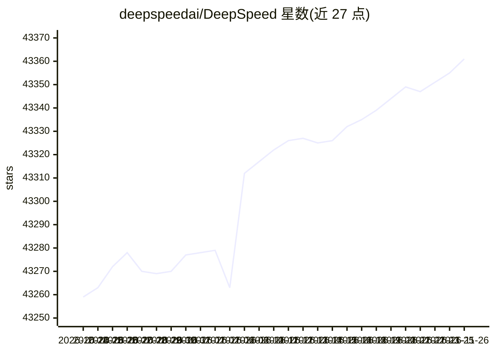

# deepspeedai/DeepSpeed

⭐ 43,361 · Python · Apache-2.0 · 推送 2026-11-25 · [GitHub](https://github.com/deepspeedai/DeepSpeed) · [官网](https://www.deepspeed.ai/) · 组织维护 · 中文 README

**给开发者的大模型分布式训练与推理优化库**

面向 PyTorch 的深度学习优化库，提供 ZeRO、ZeRO-Infinity、3D 并行、Ulysses 序列并行、DeepSpeed-MoE 等系统创新，用于简化大规模分布式训练与推理。已被用于训练 MT-530B、BLOOM、GLM 等大模型，并与 Transformers、Accelerate、Lightning、MosaicML 等框架集成。含 C++/CUDA 扩展（ops），默认以 JIT 方式依赖 ninja 在运行时编译链接，Windows 部分功能（AIO/GDS）不支持。维护方为 DeepSpeed 团队，源自微软 AI at Scale 计划。

## 筛选速览

| 维度 | 判定 | 备注 |
|---|---|---|
| AI 角色 | `ai-ecosystem` | LLM/agent 周边工具 |
| 许可风险 | `permissive` | Apache-2.0 |
| 部署形态 | `library` | 以包/库形式分发 |
| 模型依赖 | — | README 未给出锁定关系 |
| 硬件要求 | — | 无带数字的原话,不猜 |
| 安装摩擦 | `high` | 编译与系统依赖俱全 |
| 成熟度 | — | 结构信号不足 |

## 动量与使用信号

- 维护:`active` — 距上次 push 0.7 天,年发版 17,433 位贡献者
- 涨星:近 1 天 **+2**(自 20261016 起算)
- 安装:pypi 包 `deepspeed` 月下载 1,054,708

## 能力要点

- ZeRO/ZeRO-Infinity/3D 并行等分布式训练机制
- 支持训练与推理两类场景及压缩
- 与 Transformers/Accelerate/Lightning 等框架集成
- 多硬件后端：NVIDIA、AMD、CPU、Intel Gaudi/XPU、Apple MPS、华为昇腾

## 适用场景

- 训练千亿参数规模的大语言模型
- 为已有 PyTorch 训练代码添加分布式与显存优化
- 在多种 GPU/NPU 加速器上部署推理

## 场景标签

`模型训练` `推理引擎` `模型量化` · 领域:训练与推理

## 证据(README 行号)

> L56: # Extreme Speed and Scale for DL Training
> L80: DeepSpeed has been integrated with several different popular open-source DL frameworks such as:
> L105: # Installation

## 星数曲线

2026-10-24 43,259 → 2026-11-26 43,361（+102）

---
*卡片 v1 · prompt 1.4 · 生成 2026-11-26 · 置信度 high · 依据 README sha `d56a656e8abd` · [字段定义](../../DATASET.md)*
