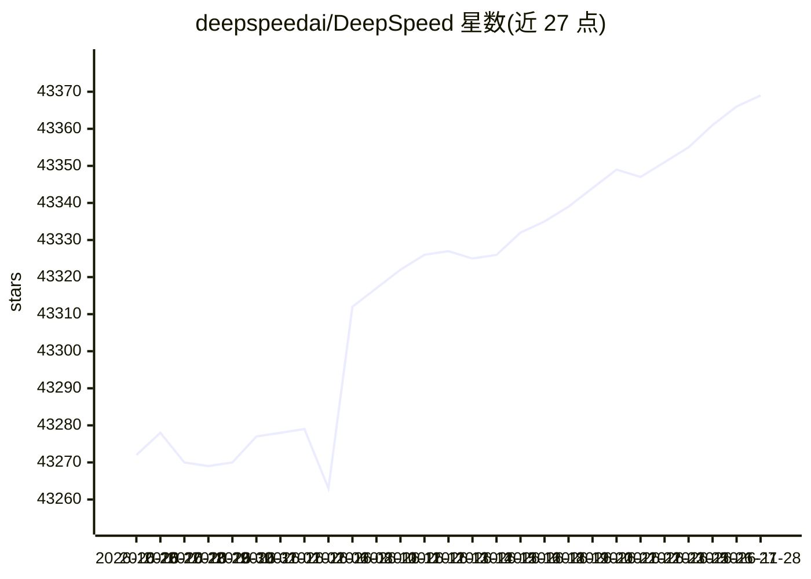

# deepspeedai/DeepSpeed

⭐ 43,369 · Python · Apache-2.0 · 推送 2026-11-27 · [GitHub](https://github.com/deepspeedai/DeepSpeed) · [官网](https://www.deepspeed.ai/) · 组织维护 · 中文 README

**面向大模型开发者的分布式训练与推理优化库**

DeepSpeed 是一个深度学习优化库，通过 ZeRO、ZeRO-Infinity、3D 并行、Ulysses 序列并行、DeepSpeed-MoE 等系统创新，支持大规模模型的分布式训练与推理。README 列出曾用于训练的模型（MT-530B、BLOOM 等），并与 Transformers、Accelerate、Lightning、MosaicML 等框架集成。安装需先装 PyTorch，C++/CUDA 扩展默认通过 JIT 编译，Windows 上部分功能不可用（AIO、GDS）。

## 筛选速览

| 维度 | 判定 | 备注 |
|---|---|---|
| AI 角色 | `ai-ecosystem` | LLM/agent 周边工具 |
| 许可风险 | `permissive` | Apache-2.0 |
| 部署形态 | `library` | 以包/库形式分发 |
| 模型依赖 | — | README 未给出锁定关系 |
| 硬件要求 | — | 无带数字的原话,不猜 |
| 安装摩擦 | `high` | 编译与系统依赖俱全 |
| 成熟度 | — | 结构信号不足 |

## 动量与使用信号

- 维护:`active` — 距上次 push 0.7 天,年发版 17,433 位贡献者
- 涨星:近 1 天 **+2**(自 20261016 起算)
- 安装:pypi 包 `deepspeed` 月下载 1,054,708

## 能力要点

- ZeRO/ZeRO-Infinity、3D 并行、Ulysses 序列并行、MoE 等训练优化技术
- 支持训练与推理两个环节，含压缩与 MoE 能力
- 多硬件加速器支持：NVIDIA/AMD GPU、Ascend NPU、Gaudi2、XPU、Apple MPS
- 提供 ds_report 环境报告工具验证安装与扩展兼容性

## 适用场景

- 训练超大规模模型时降低显存与通信开销
- 为现有 PyTorch/Transformers 训练流程接入分布式优化
- 在多类国产及异构加速器上运行大模型训练

## 场景标签

`模型训练` `推理引擎` · 领域:训练与推理

## 证据(README 行号)

> L60: ***DeepSpeed enabled the world's most powerful language models (at the time of this writing) such as MT-530B and BL
> L82: DeepSpeed has been integrated with several different popular open-source DL frameworks such as:
> L107: # Installation

## 星数曲线

2026-10-26 43,272 → 2026-11-28 43,369（+97）

---
*卡片 v1 · prompt 1.4 · 生成 2026-11-28 · 置信度 high · 依据 README sha `996346caa407` · [字段定义](../../DATASET.md)*
