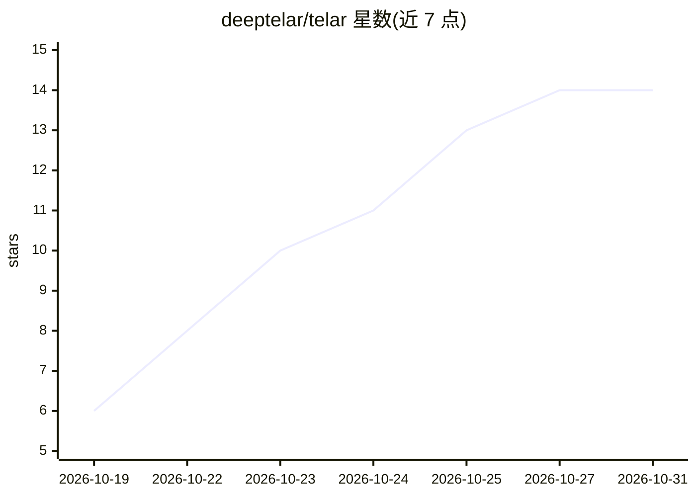

# deeptelar/telar

⭐ 14 · Kotlin · Apache-2.0 · 推送 2026-10-30 · [GitHub](https://github.com/deeptelar/telar) · [官网](https://deeptelar.github.io/telar/) · 个人维护

**Kotlin 多平台 AI agent 与工作流框架：类型化图编排**

面向 Kotlin 开发者的 agent 与工作流框架：把每个步骤写成 data class 上的 suspend 函数，用边连接成类型化图，由引擎负责循环、并行步骤、流式输出、存档点与人工审批中断恢复。提供 toolAgent 现成工具调用循环，通过 telar-anthropic / telar-openai 等模块接入 Claude、OpenAI、Gemini、Ollama、Groq 等，亦可接任意 MCP server 工具。核心仅依赖 kotlinx-coroutines，运行于 JVM、Android、iOS、浏览器等平台。项目自称灵感来自 LangGraph，处于 alpha 阶段（0.1.0-alpha14），API 在 1.0 前可能变动，README 建议需要稳定 API 者选 Koog、LangGraph4j 或 LangChain4j。

## 筛选速览

| 维度 | 判定 | 备注 |
|---|---|---|
| AI 角色 | `ai-ecosystem` | LLM/agent 周边工具 |
| 许可风险 | `permissive` | Apache-2.0 |
| 部署形态 | `None` |  |
| 模型依赖 | local-ok | 支持本地模型 |
| 硬件要求 | — | 无带数字的原话,不猜 |
| 安装摩擦 | `low` | 无编译、无系统依赖或容器化 |
| 成熟度 | `idea` | |

## 能力要点

- 类型化图编排：节点为 suspend 函数，compile() 阶段校验图结构错误
- 任意节点可中断等待人工审批，跨进程/重启后 resume 继续
- 支持 Claude/OpenAI/Gemini/Ollama/Groq 及 MCP server 工具
- 核心仅依赖 kotlinx-coroutines，覆盖 JVM、Android、iOS、JS、Wasm

## 适用场景

- 在 Kotlin 多平台应用中构建带人工审批的多步骤 agent 工作流
- 需要跨重启持久化的长时运行 agent 流程
- 在 Android/iOS/浏览器上复用同一套 agent 图代码

## 场景标签

`Agent 框架` `工作流自动化` · 领域:Agent 开发

## 证据(README 行号)

> L8: **AI agents and workflows for Kotlin, as small typed graphs.** You write each step as a `suspend`
> L80: - **Any model, small surface.** Claude, OpenAI, Gemini, Ollama and every server with the API of
> L42: implementation("dev.deeptelar:telar-anthropic:0.1.0-alpha14") // or telar-openai: OpenAI, Gemini, Ollama, Groq, ...

## 星数曲线

2026-10-19 6 → 2026-10-31 14（+8）

---
*卡片 v1 · prompt 1.4 · 生成 2026-10-31 · 置信度 high · 依据 README sha `0d0103c1842c` · [字段定义](../../DATASET.md)*
