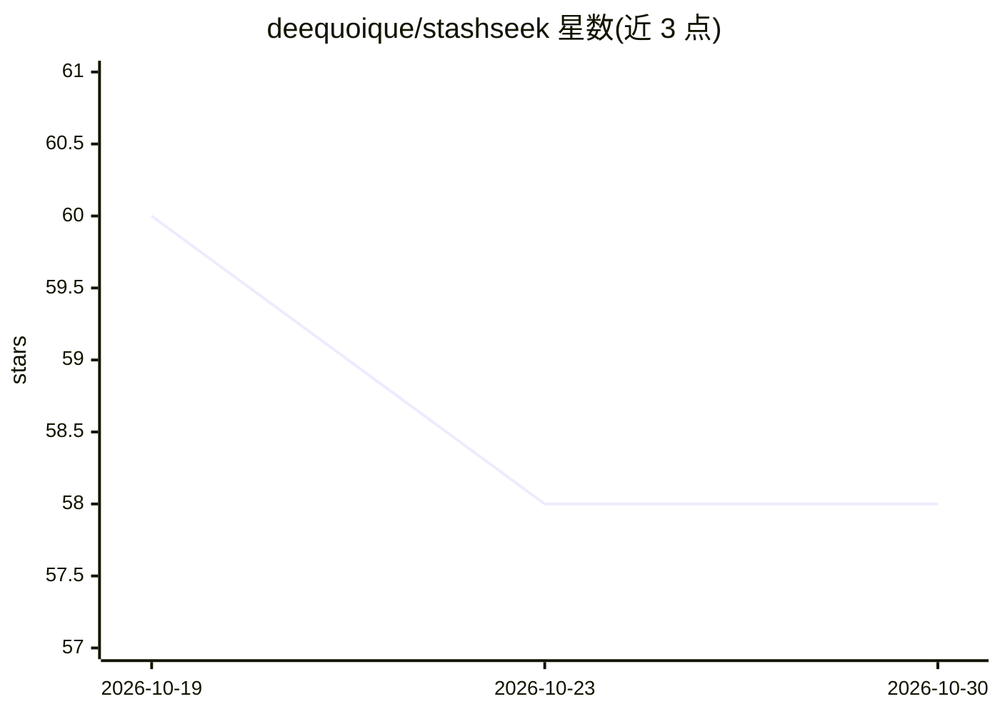

# deequoique/stashseek

⭐ 58 · Python · AGPL-3.0 · 推送 2026-10-21 · [GitHub](https://github.com/deequoique/stashseek) · [官网](https://notebookai.deequoique.tech) · 个人维护 · 中文 README

**与收藏视频对话的自托管应用：答案带时间戳可回溯原视频**

面向深度学习者、科研与知识工作者的视频知识库对话应用：通过浏览器扩展、MCP 或可选的 Telegram/微信入口收藏 YouTube/Bilibili 视频，后台异步提取标题、章节与字幕，检索在用户私有库内进行（PostgreSQL 全文 + pgvector 语义混合检索），回答附来源标题、引文与可跳转时间戳，证据不足时输出有界结果。支持自托管，需 Python 3.11+、Docker Compose、PostgreSQL、Redis、S3 兼容存储及 Agent 模型与智谱 Embedding API 凭据。系 EAZO 黑客松项目，AGPLv3 许可。

## 筛选速览

| 维度 | 判定 | 备注 |
|---|---|---|
| AI 角色 | `ai-native` | 本体是模型或模型工具 |
| 许可风险 | `viral` | AGPL-3.0 |
| 部署形态 | `self-host` | docker 或自建部署 |
| 模型依赖 | — | README 未给出锁定关系 |
| 硬件要求 | — | 无带数字的原话,不猜 |
| 安装摩擦 | `low` | 无编译、无系统依赖或容器化 |
| 成熟度 | `idea` | |

## 能力要点

- 混合检索（PostgreSQL 全文 + pgvector 语义）在用户私有库内进行
- 回答含来源标题、引文与可跳转时间戳，证据不足时输出有界结果
- MCP 入口支持 stdio 与 Streamable HTTP，授权分 read/full 作用域
- 可选浏览器伴生组件读取需登录页面的字幕且不上传 Cookie 与凭据

## 适用场景

- 复习长课程时找回某个概念出自哪节课哪个时间点
- 对比多个收藏访谈中讲者的观点异同并核验出处
- 私有化部署视频知识库并通过扩展、MCP 或聊天入口提问

## 场景标签

`知识库管理` `RAG` · 领域:知识与检索

## 证据(README 行号)

> L7: StashSeek Chat is a browser-first conversational Agent for the videos and content you have saved. Save a source, ask
> L57: 4. **Receive an evidence-backed answer:** the answer includes video titles, quoted excerpts, and jumpable timestamp
> L63: - Server-validated citations with source titles, real URLs, excerpts, and timestamps. When the library does not con

## 星数曲线

2026-10-19 60 → 2026-10-30 58（-2）

---
*卡片 v1 · prompt 1.4 · 生成 2026-10-24 · 置信度 mid · 依据 README sha `ed24a5f966fc` · [字段定义](../../DATASET.md)*
