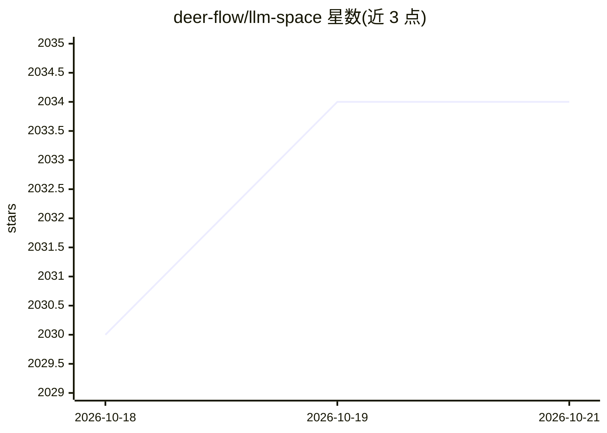

# deer-flow/llm-space

⭐ 2,045 · TypeScript · MIT · 推送 2026-10-12 · [GitHub](https://github.com/deer-flow/llm-space) · [官网](https://deer-flow.github.io/llm-space/) · 组织维护 · 中文 README

**给 agent 开发者的桌面原型与调试工具：构建、追踪、回放、评测**

面向 agent 构建者的 macOS 桌面应用：编写并版本化管理 prompt、工具与模型设置，实时查看 agent 循环中每次模型调用与工具运行，从历史回放运行逐步定位失败，跨运行评测性能；还可由 AI 生成 prompt 与工具并把任意会话转为可运行的 LangGraph agent。文件与 API key 保留在本机，线程以文件形式管理。基于 TypeScript/Bun 与 Electrobun 桌面壳，提供 DMG 安装包（系统 WebView 版与内嵌渲染引擎版），DeerFlow 项目将其作为自用开发工具。

## 筛选速览

| 维度 | 判定 | 备注 |
|---|---|---|
| AI 角色 | `ai-ecosystem` | LLM/agent 周边工具 |
| 许可风险 | `permissive` | MIT |
| 部署形态 | `None` |  |
| 模型依赖 | — | README 未给出锁定关系 |
| 硬件要求 | — | 无带数字的原话,不猜 |
| 安装摩擦 | `low` | 无编译、无系统依赖或容器化 |
| 成熟度 | — | 结构信号不足 |

## 能力要点

- 实时追踪 agent 循环中每次模型调用与工具运行
- 从历史回放运行并逐步调试失败
- 跨运行评测 agent 性能
- AI 生成 prompt/工具，可将会话转为 LangGraph agent

## 适用场景

- 在桌面端原型化 agent 想法并管理 prompt 版本
- 调试 agent 执行链路中的失败步骤
- 评测 agent 跨运行的性能表现

## 场景标签

`提示工程` `LLM 可观测性` `模型评测` · 领域:Agent 开发

## 证据(README 行号)

> L17: **LLM Space** v4 is a desktop app for agent builders — prototype your next agent ideas, inspect every step of your 
> L28: - **Trace** — see every model call and tool run inside the agent loop as it happens.
> L30: - **Evaluate** — measure how your agent performs across runs.

## 星数曲线

2026-10-18 2,030 → 2026-10-21 2,034（+4）

---
*卡片 v1 · prompt 1.4 · 生成 2026-10-21 · 置信度 high · 依据 README sha `0a16feba910f` · [字段定义](../../DATASET.md)*
