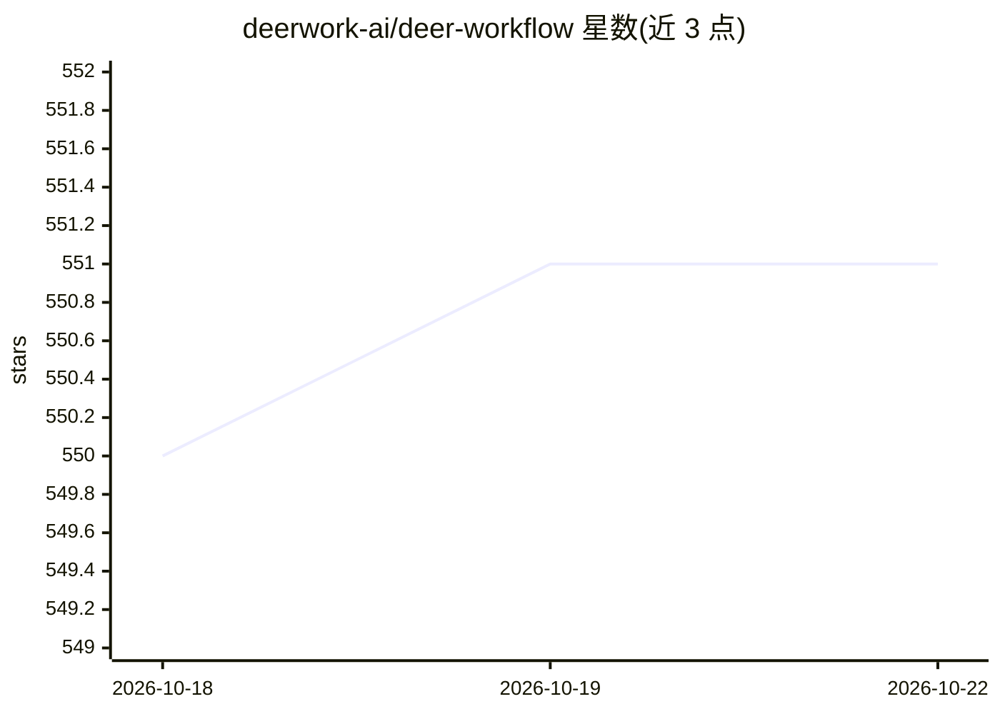

# deerwork-ai/deer-workflow

⭐ 551 · TypeScript · MIT · 推送 2026-08-09 · [GitHub](https://github.com/deerwork-ai/deer-workflow) · [官网](https://deerwork-ai.github.io/deer-workflow/) · 组织维护 · 中文 README

**TypeScript 编排的动态工作流运行时，节点内语义工作交给可替换 Agent**

面向开发者的动态 Workflow 运行时，采用 Graph Engineering 模式：用 TypeScript 定义控制流、阶段、输入与失败处理，节点内的语义工作委托给可替换的 Coding Agent 运行时。默认运行时为 Codex CLI，内置 Claude Code 与 Pi Harness，Agent 接口保持厂商中立。提供 CLI 通过自然语言描述生成可运行的 TypeScript 工作流模块，交互运行提供阶段感知 TUI，自动化可消费 JSONL 事件流。基于 Bun 安装，MIT 许可。

## 筛选速览

| 维度 | 判定 | 备注 |
|---|---|---|
| AI 角色 | `ai-ecosystem` | LLM/agent 周边工具 |
| 许可风险 | `permissive` | MIT |
| 部署形态 | `None` |  |
| 模型依赖 | — | README 未给出锁定关系 |
| 硬件要求 | — | 无带数字的原话,不猜 |
| 安装摩擦 | `low` | 无编译、无系统依赖或容器化 |
| 成熟度 | — | 结构信号不足 |

## 能力要点

- TypeScript 定义执行路径，控制流可审查而非藏在 Agent 对话中
- Agent 运行时可替换：默认 Codex CLI，内置 Claude Code 与 Pi
- CLI 可从自然语言描述生成可运行的 TypeScript 工作流模块
- 交互 TUI 展示阶段，自动化消费稳定 JSONL 事件流

## 适用场景

- 用代码定义并运行多阶段 Agent 编排（如并行研究并合成报告）
- 在服务器/CI 中以 JSONL 事件流消费工作流执行
- 更换不同 Coding Agent 运行时执行同一工作流

## 场景标签

`Agent 框架` · 领域:Agent 开发

## 证据(README 行号)

> L13: An open-source Dynamic Workflow runtime for building observable, reusable Agent
> L24: Deer Workflow is a code-first implementation of **Graph Engineering**: TypeScript defines the valid execution paths

## 星数曲线

2026-10-18 550 → 2026-10-22 551（+1）

---
*卡片 v1 · prompt 1.4 · 生成 2026-10-21 · 置信度 high · 依据 README sha `f338d468c063` · [字段定义](../../DATASET.md)*
