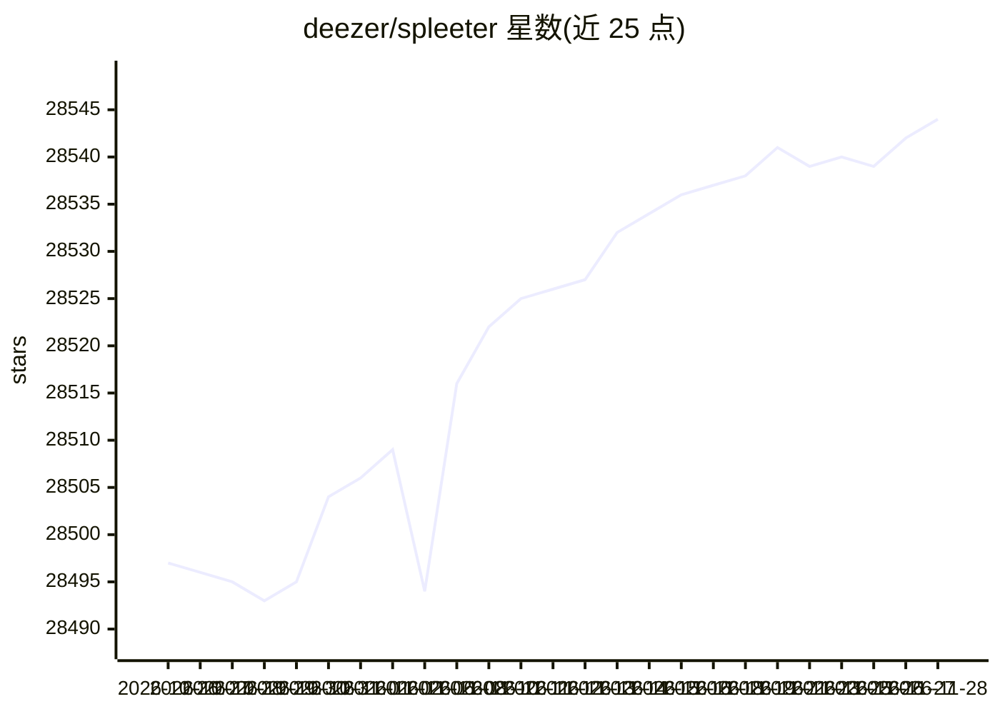

# deezer/spleeter

⭐ 28,544 · Python · MIT · 推送 2026-10-28 · [GitHub](https://github.com/deezer/spleeter) · [官网](https://research.deezer.com/projects/spleeter.html) · 组织维护

**给开发者的预训练音源分离库：分离人声/伴奏/鼓/贝斯**

Deezer 开源的 Python 音源分离库，基于 TensorFlow，提供预训练模型，支持 2/4/5 stems 三种分离配置（人声/伴奏、人声/鼓/贝斯/其他、加钢琴）。既可命令行直接使用，也可作为 Python 库嵌入开发流程；官方提供 musdb 上的性能基准，GPU 上分离速度可达实时的 100 倍。安装依赖 ffmpeg 与 libsndfile；2.1.0 版本有破坏性变更并取消专用 GPU 包；另提供商业版本 Spleeter Pro。

## 筛选速览

| 维度 | 判定 | 备注 |
|---|---|---|
| AI 角色 | `ai-native` | 本体是模型或模型工具 |
| 许可风险 | `permissive` | MIT |
| 部署形态 | `self-host` | docker 或自建部署 |
| 模型依赖 | — | README 未给出锁定关系 |
| 硬件要求 | — | 无带数字的原话,不猜 |
| 安装摩擦 | `low` | 无编译、无系统依赖或容器化 |
| 成熟度 | — | 结构信号不足 |

## 动量与使用信号

- 维护:`maintenance` — 距上次 push 121.7 天,年发版 0,15 位贡献者
- 涨星:近 1 天 **+2**(自 20261016 起算)
- 安装:pypi 包 `spleeter` 月下载 8,511

## 能力要点

- 预训练模型支持 2/4/5 stems 三种音源分离配置
- 命令行与 Python 库两种使用方式
- GPU 上 4 stems 分离速度达实时的 100 倍
- 被 iZotope RX 8、SpectralLayers 7、VirtualDJ 等软件采用

## 适用场景

- 把歌曲拆成人声与伴奏用于翻唱或混音
- 在自己的音频处理流水线中嵌入分离能力
- 音乐信息检索研究中做音源分离基线

## 场景标签

 · 领域:音频/音乐信息处理

## 证据(README 行号)

> L8: **Spleeter** is Deezer source separation library with pretrained models
> L10: to train source separation model (assuming you have a dataset of isolated sources), and provides
> L17: 2 stems and 4 stems models have high performances on the musdb dataset. **Spleeter** is also very fast as it can pe

## 星数曲线

2026-10-26 28,497 → 2026-11-28 28,544（+47）

---
*卡片 v1 · prompt 1.4 · 生成 2026-11-22 · 置信度 high · 依据 README sha `349e38ff46bc` · [字段定义](../../DATASET.md)*
