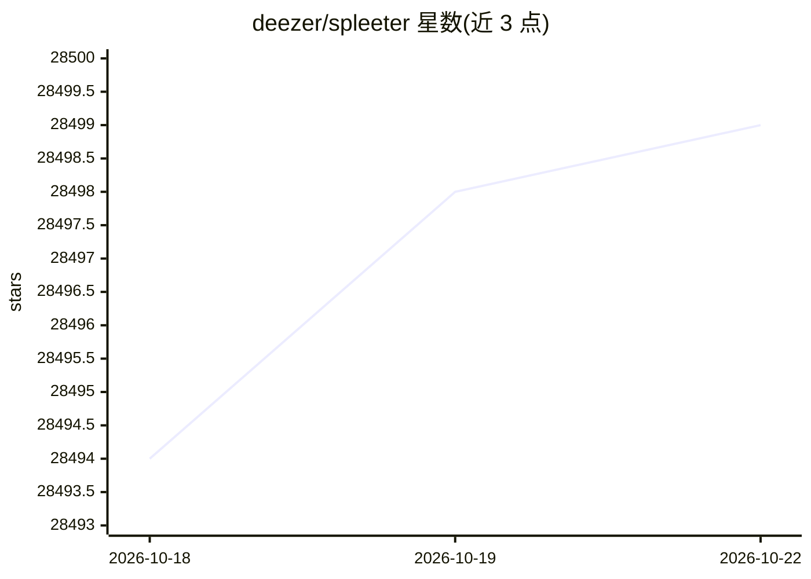

# deezer/spleeter

⭐ 28,498 · Python · MIT · 推送 2026-06-18 · [GitHub](https://github.com/deezer/spleeter) · [官网](https://research.deezer.com/projects/spleeter.html) · 组织维护

**为开发者提供音频音轨分离库与预训练模型**

Deezer 出品的 Python 音源分离库，基于 TensorFlow，提供预训练模型：2 stems（人声/伴奏）、4 stems、5 stems 三种分离配置。可从命令行直接使用，也可作为 Python 库嵌入开发管线。依赖 ffmpeg 与 libsndfile，可通过 pip 或 Docker 安装，另提供 Google Colab 在线试用。2.1.0 版本引入 CLI 选项命名变更并移除独立 GPU 包；Apple M1 芯片存在已知兼容问题；另有商业版 Spleeter Pro。

## 筛选速览

| 维度 | 判定 | 备注 |
|---|---|---|
| AI 角色 | `ai-enhanced` | 去掉 AI 部分产品仍成立 |
| 许可风险 | `dual` | MIT |
| 部署形态 | `self-host` | docker 或自建部署 |
| 模型依赖 | — | README 未给出锁定关系 |
| 硬件要求 | — | 无带数字的原话,不猜 |
| 安装摩擦 | `low` | 无编译、无系统依赖或容器化 |
| 成熟度 | — | 结构信号不足 |

## 动量与使用信号

- 维护:`maintenance` — 距上次 push 121.7 天,年发版 0,15 位贡献者
- 涨星:近 1 天 **+2**(自 20261016 起算)
- 安装:pypi 包 `spleeter` 月下载 8,511

## 能力要点

- 提供 2/4/5 stems 三种预训练分离模型
- 支持命令行与 Python 库两种使用方式
- 可 pip 或 Docker 安装，并提供 Colab 试用
- GPU 上 4 stems 分离速度达实时 100 倍

## 适用场景

- 从歌曲中分离人声与伴奏
- 将鼓、贝斯、钢琴等分轨提取为独立音频
- 在自己的音频处理管线中集成分离能力

## 场景标签

 · 领域:音频处理/深度学习

## 证据(README 行号)

> L8: **Spleeter** is Deezer source separation library with pretrained models
> L9: written in Python and uses Tensorflow. It makes it easy
> L20: as well as directly in your own development pipeline as a Python library. It can be installed with pip or be used w

## 星数曲线

2026-10-18 28,494 → 2026-10-22 28,499（+5）

---
*卡片 v1 · prompt 1.4 · 生成 2026-10-18 · 置信度 high · 依据 README sha `e01fc7a36b06` · [字段定义](../../DATASET.md)*
