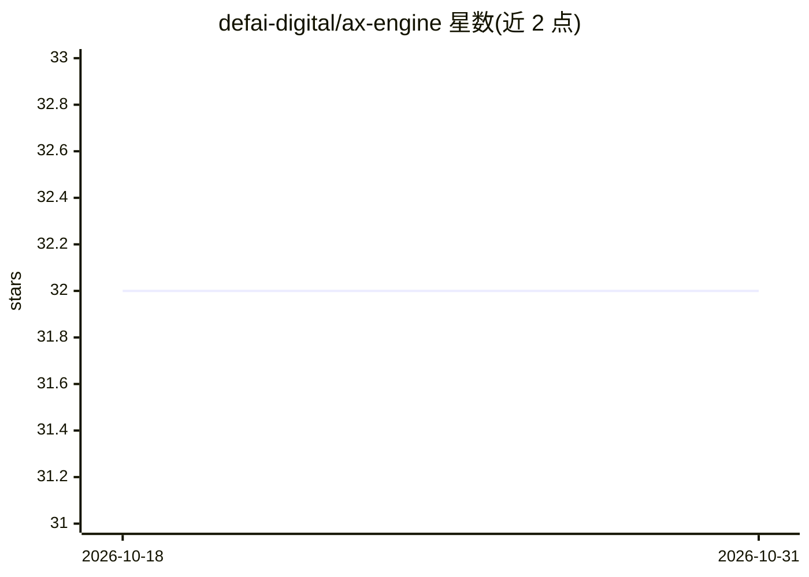

# defai-digital/ax-engine

⭐ 32 · Rust · Apache-2.0 · 推送 2026-10-30 · [GitHub](https://github.com/defai-digital/ax-engine) · [官网](https://ax-engine.app) · 组织维护

**面向 Apple Silicon 的本地多模型 LLM 推理运行时，提供 OpenAI 兼容接口**

Mac 优先的 Apple Silicon 本地推理运行时，基于 MLX 运行模型图，单进程内常驻多个 Qwen/Gemma/GLM 等模型，按请求路由（chat 与 embeddings 并存），引擎内实现连续批处理、分块预填充、分页 KV 与跨请求前缀复用，并提供图像/视频对话、OCR、Whisper 转写能力。以 OpenAI 兼容 HTTP 端点、Python 绑定与语言 SDK 交付，可经 pip、独立签名 tarball 或 Homebrew 安装。要求 macOS 26+ 与 M2 及以上芯片；MTP 加速为显式实验性 opt-in，部分量化包的准入与认证仍在流程中；NVIDIA/CUDA 机队服务归属另一产品 AX Serving。

## 筛选速览

| 维度 | 判定 | 备注 |
|---|---|---|
| AI 角色 | `ai-ecosystem` | LLM/agent 周边工具 |
| 许可风险 | `permissive` | Apache-2.0 |
| 部署形态 | `library` | 以包/库形式分发 |
| 模型依赖 | local-ok | 支持本地模型 |
| 硬件要求 | — | 无带数字的原话,不猜 |
| 安装摩擦 | `medium` | 含编译或系统依赖之一 |
| 成熟度 | `idea` | |

## 能力要点

- 单进程多模型常驻，按请求 model 字段路由 chat 与 embeddings
- 引擎内调度：连续批处理、分块预填充、分页 KV 账本与跨请求前缀复用
- MLX 图上原生运行图像/视频对话、OCR 与 Whisper 转写/翻译
- pip、独立 tarball、Homebrew 三种安装通道，端点 OpenAI 兼容

## 适用场景

- 在 Mac 上本地同时服务多个 LLM 与嵌入模型并通过 OpenAI 兼容 API 调用
- 利用前缀复用提升多请求场景下的吞吐
- 本地运行多模态对话、OCR 与语音转写端点

## 场景标签

`推理引擎` `多模态` `OCR` `语音识别` · 领域:感知与多模态

## 证据(README 行号)

> L9: Install with pip, a standalone download, or Homebrew and serve
> L73: - **You own the stack you serve** — AX runs the MLX graph, KV/runtime, and
> L95: Clients enter through the HTTP server, the Python binding, or a language SDK.

## 星数曲线

2026-10-18 32 → 2026-10-31 32（+0）

---
*卡片 v1 · prompt 1.4 · 生成 2026-10-26 · 置信度 high · 依据 README sha `2930d81cb440` · [字段定义](../../DATASET.md)*
