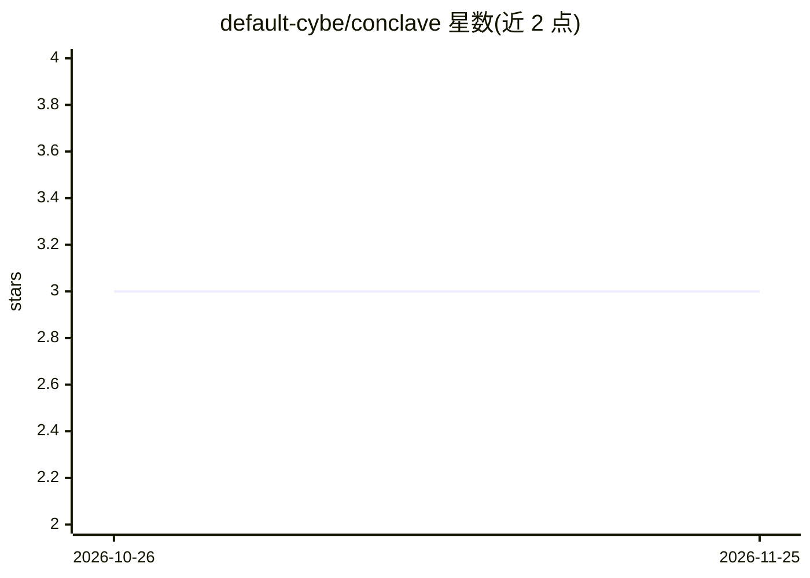

# default-cybe/conclave

⭐ 3 · TypeScript · AGPL-3.0 · 推送 2026-11-19 · [GitHub](https://github.com/default-cybe/conclave) · [官网](https://conclave.dymnitguys.com) · 个人维护

**自托管 coding agent 中枢：自有设备上运行多模型编程代理**

在自有服务器或桌面运行的中枢（hub），持有 agent 循环、聊天、记忆、例程与密钥；PC/Mac 通过 WebSocket 外呼接入，无需开放端口。为任意模型提供 Claude Code 公开设计来源的工具集（Read/Write/Edit/Bash 等与权限规则、hooks、skills、子代理），带编辑后验证门（失败回传最多 3 次）、多模型陪审/辩论、用量限额 failover、经 CLIProxyAPI 的订阅登录，以及手机审批、审计日志。提供 Web/桌面/Android/终端客户端，AGPL-3.0，另有商业许可。

## 筛选速览

| 维度 | 判定 | 备注 |
|---|---|---|
| AI 角色 | `ai-ecosystem` | LLM/agent 周边工具 |
| 许可风险 | `dual` | AGPL-3.0 |
| 部署形态 | `desktop` | 安装包/桌面程序 |
| 模型依赖 | locked-api |  |
| 硬件要求 | — | 无带数字的原话,不猜 |
| 安装摩擦 | `low` | 无编译、无系统依赖或容器化 |
| 成熟度 | — | 结构信号不足 |

## 能力要点

- 为任意模型提供统一 harness：Claude Code 同款工具集、权限规则、hooks、skills、子代理
- 验证门：编辑文件的回合须在会话设备上跑项目检查，失败回传最多 3 次
- 用量限额 failover：按账号顺序切换计划/密钥，再按模型 fallback 列表
- 经 ACP 驱动 Claude Code/Codex/Gemini CLI/OpenCode，并与 Claude Code 双向同步

## 适用场景

- 在家庭服务器或 Proxmox 上集中管理多台机器的 coding agent
- 同一会话中混合使用多家模型并做交叉评审
- 通过手机审批代理的高风险操作

## 场景标签

`编码 Agent` `多智能体` · 领域:Agent 开发

## 证据(README 行号)

> L10: Conclave runs coding agents on your own computers with any model, checks their work before a turn ends, and lets yo
> L12: It is a hub you run on a home server, a Proxmox box or your desktop. The hub holds the agent loop, chats, memory, r
> L21: - **Vendor CLIs in the same transcript.** Claude Code, Codex, Gemini CLI and OpenCode run as engines over the Agent

## 星数曲线

2026-10-26 3 → 2026-11-25 3（+0）

---
*卡片 v1 · prompt 1.4 · 生成 2026-11-22 · 置信度 high · 依据 README sha `a84cec104741` · [字段定义](../../DATASET.md)*
