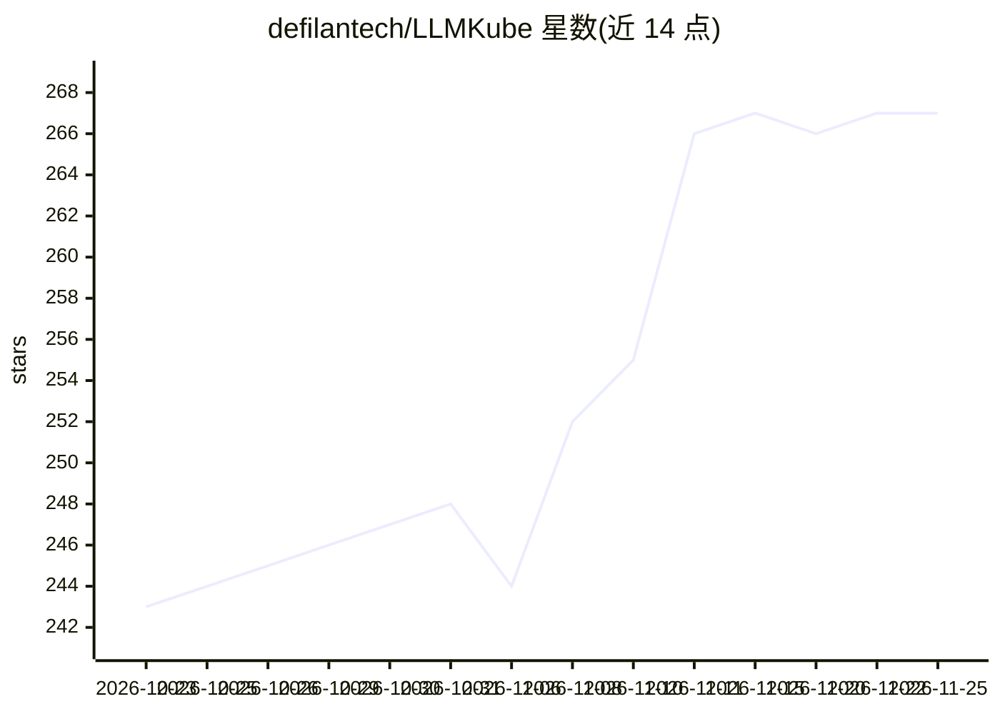

# defilantech/LLMKube

⭐ 267 · Go · Apache-2.0 · 推送 2026-11-23 · [GitHub](https://github.com/defilantech/LLMKube) · [官网](https://llmkube.com) · 组织维护

**跨异构 GPU 集群自托管 LLM 推理的 Kubernetes operator**

LLMKube 是一个 Go 编写的 Kubernetes operator，把自托管 LLM 推理简化为 Model 与 InferenceService 两个 CRD，由 operator 处理模型下载、缓存、GPU 调度、健康检查、扩缩容并暴露 OpenAI 兼容 API。支持 NVIDIA CUDA、AMD/Intel Vulkan、Apple Silicon Metal 等异构节点共用一套控制平面；Metal Agent 以原生 macOS 进程运行 llama-server/mlx-server 以访问 Metal GPU。ModelRouter 提供本地与外部模型间的 fail-closed 策略路由。项目处于 pre-1.0，CRD 均为 v1alpha1，字段可能在次版本间变更。

## 筛选速览

| 维度 | 判定 | 备注 |
|---|---|---|
| AI 角色 | `ai-ecosystem` | LLM/agent 周边工具 |
| 许可风险 | `permissive` | Apache-2.0 |
| 部署形态 | `library` | 以包/库形式分发 |
| 模型依赖 | local-ok | 支持本地模型 |
| 硬件要求 | — | 无带数字的原话,不猜 |
| 安装摩擦 | `high` | 编译与系统依赖俱全 |
| 成熟度 | `idea` | |

## 能力要点

- Model/InferenceService 两个 CRD 声明式部署，自动下载权重并暴露 OpenAI 兼容 API
- Metal Agent 以原生 macOS 进程运行 llama-server/mlx-server，直接访问 Metal GPU
- 同一 operator 管理 NVIDIA/AMD/Intel/Apple Silicon 异构节点
- ModelRouter 提供带预算与 fail-closed 语义的本地/云端策略路由

## 适用场景

- 在自有机房或离线（air-gapped）环境用 Kubernetes 托管 LLM 推理
- 把 Mac Studio 与 NVIDIA GPU 节点纳入同一推理集群统一编排
- 对含 pii/phi 标注的请求强制只路由到本地模型后端

## 场景标签

`推理引擎` · 领域:训练与推理

## 证据(README 行号)

> L5:  ### The Kubernetes operator for self-hosted LLM inference
> L55: **LLMKube is a Kubernetes operator that turns LLM deployment into a two-resource YAML problem.** Define a `Model` a
> L122: - **What CI covers:** on every pull request the default end-to-end job deploys the operator to a kind cluster and 

## 星数曲线

2026-10-23 243 → 2026-11-25 267（+24）

---
*卡片 v1 · prompt 1.4 · 生成 2026-11-25 · 置信度 high · 依据 README sha `688732a7af4b` · [字段定义](../../DATASET.md)*
