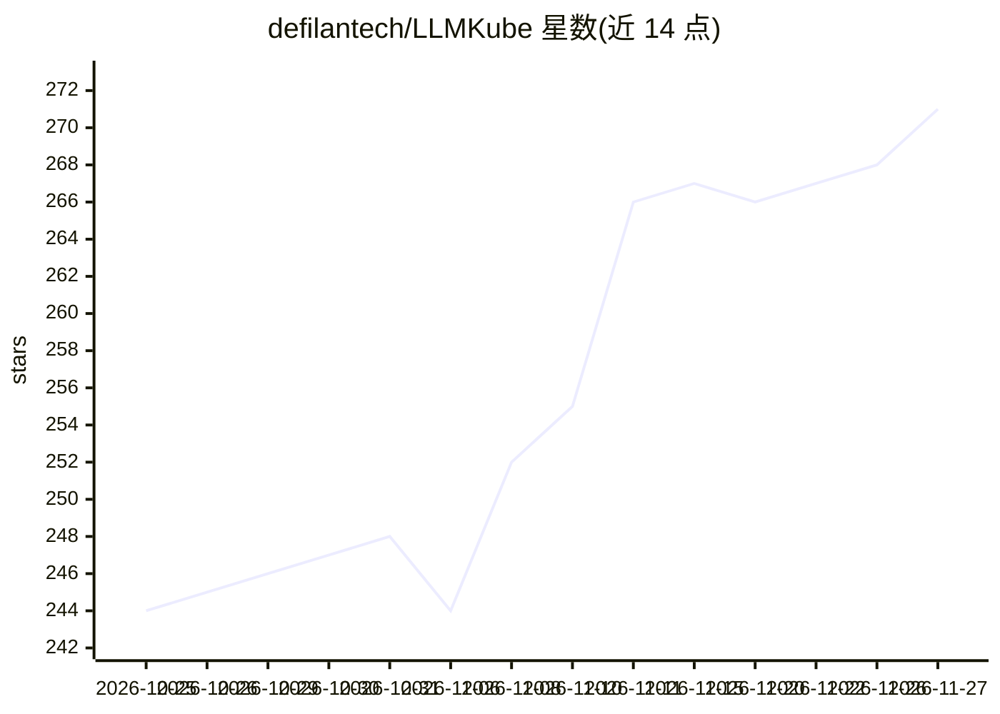

# defilantech/LLMKube

⭐ 271 · Go · Apache-2.0 · 推送 2026-11-26 · [GitHub](https://github.com/defilantech/LLMKube) · [官网](https://llmkube.com) · 组织维护

**Kubernetes operator：在异构 GPU 集群上自托管 LLM 推理**

LLMKube 是一个 Go 编写的 Kubernetes operator，将自托管 LLM 部署抽象为 Model 与 InferenceService 两个 CRD，由 operator 处理模型下载、缓存、GPU 调度、健康检查、扩缩容并暴露 OpenAI 兼容 API。支持的运行时包括 llama.cpp、vLLM、TGI、mlx-server；Metal Agent 以原生 macOS 进程方式接入 Apple Silicon 主机，实现 NVIDIA/AMD(Vulkan)/Intel/Apple Silicon 混合机群统一管理。ModelRouter 提供本地与外部 provider 间的 fail-closed 策略路由。当前为 pre-1.0，CRD 均为 v1alpha1，字段可能在次版本间变更。

## 筛选速览

| 维度 | 判定 | 备注 |
|---|---|---|
| AI 角色 | `ai-ecosystem` | LLM/agent 周边工具 |
| 许可风险 | `permissive` | Apache-2.0 |
| 部署形态 | `library` | 以包/库形式分发 |
| 模型依赖 | local-ok | 支持本地模型 |
| 硬件要求 | — | 无带数字的原话,不猜 |
| 安装摩擦 | `high` | 编译与系统依赖俱全 |
| 成熟度 | `idea` | |

## 能力要点

- Metal Agent 以原生 macOS 进程运行 llama-server/mlx-server，获得完整 Metal GPU 访问
- 一个 operator 与一套 CRD 统一管理 NVIDIA、AMD(Vulkan)、Intel、Apple Silicon 主机
- ModelRouter 提供本地/外部模型的 fail-closed 策略路由与 pii/phi 标签约束
- OpenAI 兼容流式端点，可对接 LangChain、LlamaIndex、OpenAI Agents SDK 等

## 适用场景

- 在 on-prem/air-gapped 环境由平台团队统一编排 LLM 推理
- 把混合硬件（云 NVIDIA 节点 + 本地 Mac Studio）纳入同一控制平面
- 按 pii/phi 分类标签强制敏感请求只走本地后端

## 场景标签

`推理引擎` · 领域:训练与推理

## 证据(README 行号)

> L5:  ### The Kubernetes operator for self-hosted LLM inference
> L55: **LLMKube is a Kubernetes operator that turns LLM deployment into a two-resource YAML problem.** Define a `Model` a

## 星数曲线

2026-10-25 244 → 2026-11-27 271（+27）

---
*卡片 v1 · prompt 1.4 · 生成 2026-11-27 · 置信度 high · 依据 README sha `0401fd917f3b` · [字段定义](../../DATASET.md)*
