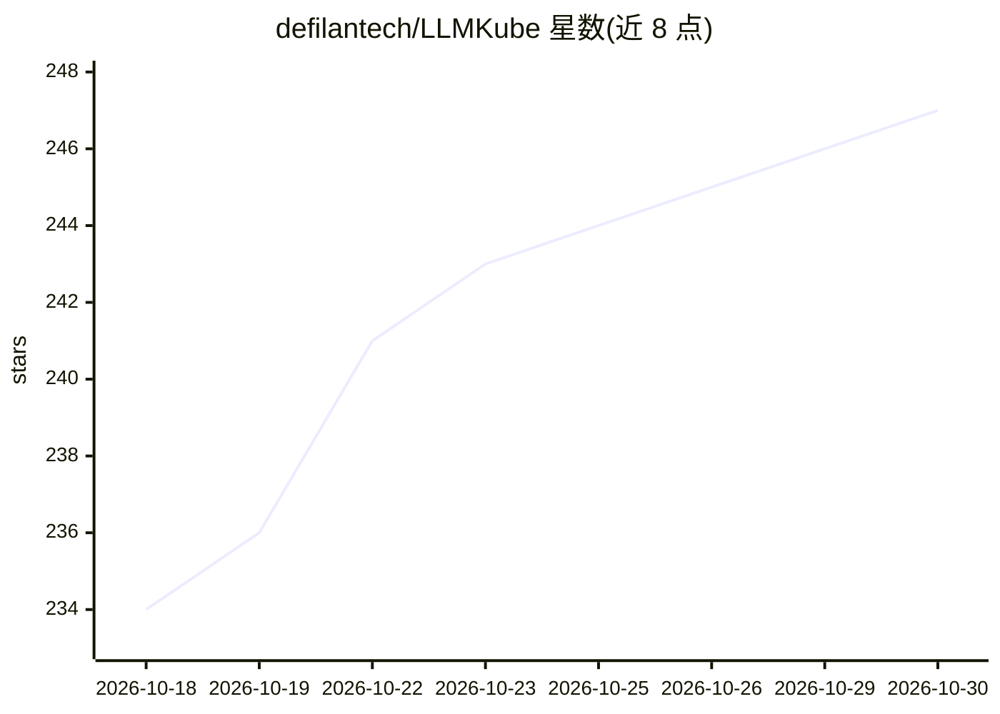

# defilantech/LLMKube

⭐ 247 · Go · Apache-2.0 · 推送 2026-10-29 · [GitHub](https://github.com/defilantech/LLMKube) · [官网](https://llmkube.com) · 组织维护

**面向异构 GPU 集群的自托管 LLM 推理 Kubernetes operator**

Kubernetes operator，通过 Model 与 InferenceService 两类 CRD 管理 LLM 的下载、缓存、GPU 调度、健康检查、扩缩容并暴露 OpenAI 兼容 API；支持 NVIDIA、AMD(Vulkan)、Intel 与 Apple Silicon 异构集群，其中 Mac 上的 Metal Agent 以原生 macOS 进程运行 llama-server/mlx-server 获得 Metal GPU 访问。ModelRouter CRD 在本地与外部提供商（Anthropic/OpenAI/LiteLLM）之间做策略路由，对受监管数据采用 fail-closed 语义。面向平台与 AI 运维团队，Apache-2.0 许可，含 Foreman 编排附加组件。单机场景 README 指出 Ollama 更简单。

## 筛选速览

| 维度 | 判定 | 备注 |
|---|---|---|
| AI 角色 | `ai-ecosystem` | LLM/agent 周边工具 |
| 许可风险 | `permissive` | Apache-2.0 |
| 部署形态 | `library` | 以包/库形式分发 |
| 模型依赖 | local-ok | 支持本地模型 |
| 硬件要求 | — | 无带数字的原话,不猜 |
| 安装摩擦 | `high` | 编译与系统依赖俱全 |
| 成熟度 | — | 结构信号不足 |

## 能力要点

- 两行 YAML 定义 Model + InferenceService，operator 处理下载/缓存/GPU 调度/OpenAI 兼容 API
- Metal Agent 在 Apple Silicon 上以原生 macOS 进程运行推理，Metal GPU 全量访问
- ModelRouter 做本地+外部提供商的策略路由，fail-closed 保证监管数据不外泄
- Foreman 附加组件：在自有集群上编排编码 agent 的多节点流水线

## 适用场景

- 在自有/气隙集群上统一管理跨 NVIDIA、AMD、Apple Silicon 的 LLM 推理
- 让本地模型 agent 按 PII/PHI 策略选择性回退到云端模型
- Mac Studio 与 Linux GPU 服务器组成同一集群提供低延迟推理

## 场景标签

`推理引擎` `模型网关` · 领域:Agent 开发

## 证据(README 行号)

> L9:  Three things no other Kubernetes LLM operator combines: Apple Silicon inference as **native macOS processes, not co
> L56: **LLMKube is a Kubernetes operator that turns LLM deployment into a two-line YAML problem.** Define a `Model` and a
> L11:  **Who it's for:** platform and AI-ops teams running on-prem, mixed-hardware, or air-gapped inference. If you want 

## 星数曲线

2026-10-18 234 → 2026-10-30 247（+13）

---
*卡片 v1 · prompt 1.4 · 生成 2026-10-22 · 置信度 high · 依据 README sha `d2da2409e965` · [字段定义](../../DATASET.md)*
