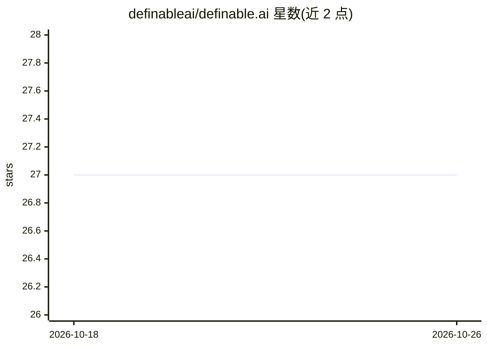

# definableai/definable.ai

⭐ 27 · Python · Apache-2.0 · 推送 2026-06-26 · [GitHub](https://github.com/definableai/definable.ai) · [官网](https://docs.definable.ai) · 组织维护

**给开发者的 Python LLM Agent 应用构建框架**

Definable 是一个构建 LLM agent 应用的 Python 框架，面向开发者，提供工具调用、RAG、持久化记忆、护栏、技能、文件读取、浏览器自动化（Playwright CDP，55 个工具）、MCP 客户端、Telegram/Discord/桌面/CLI 接口及多模型接入（OpenAI、DeepSeek、Ollama 等，可切换 provider 而不改代码）。关键机制包括 8 阶段执行管线、结构化输出（Pydantic）、观测面板与 Replay 对比。知识库需显式配置向量数据库（knowledge=True 会抛 ValueError），多种后端（Qdrant、ChromaDB 等）为可选 extras。以 pip 安装，Apache 2.0 许可。

## 筛选速览

| 维度 | 判定 | 备注 |
|---|---|---|
| AI 角色 | `ai-ecosystem` | LLM/agent 周边工具 |
| 许可风险 | `permissive` | Apache-2.0 |
| 部署形态 | `library` | 以包/库形式分发 |
| 模型依赖 | local-ok | 支持本地模型 |
| 硬件要求 | — | 无带数字的原话,不猜 |
| 安装摩擦 | `low` | 无编译、无系统依赖或容器化 |
| 成熟度 | — | 结构信号不足 |

## 能力要点

- 8 阶段 agentic 管线，并行工具调用与子 agent 支持
- RAG 支持多种嵌入器、向量库与重排器，自动检索
- 护栏在输入/输出/工具调用检查点执行 PII 脱敏、话题阻断等
- agent.serve() 单进程提供 webhooks、cron 触发与观测面板

## 适用场景

- 构建带工具调用与 RAG 的生产级 LLM agent
- 将同一 agent 接入 Telegram、Discord 等多平台
- 通过 MockModel 与 Replay 对 agent 行为做测试与对比

## 场景标签

`Agent 框架` `RAG` `浏览器自动化` · 领域:Agent 开发

## 证据(README 行号)

> L3:  Build LLM agents that work in production.
> L15: A Python framework for building agent applications with tools, RAG, persistent memory, guardrails, skills, file rea
> L242: |**Models**|OpenAI, DeepSeek, Moonshot, xAI, Anthropic, Mistral, Google Gemini, Perplexity, Ollama, OpenRouter, an

## 星数曲线

2026-10-18 27 → 2026-10-26 27（+0）

---
*卡片 v1 · prompt 1.4 · 生成 2026-10-26 · 置信度 high · 依据 README sha `d54a0a83fa36` · [字段定义](../../DATASET.md)*
