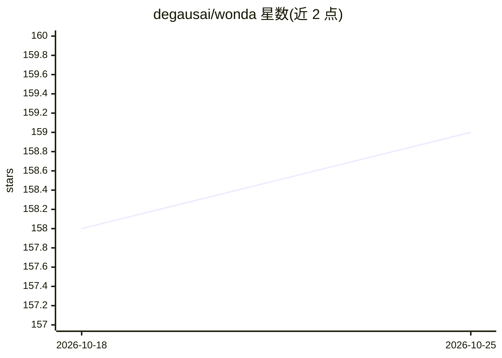

# degausai/wonda

⭐ 159 · TypeScript · 推送 2026-10-23 · [GitHub](https://github.com/degausai/wonda) · [官网](https://wonda.sh) · 组织维护

**终端 AI 内容生成 CLI：图像/视频/音乐生成、编辑与社媒发布**

面向 AI coding agent 的命令行内容生成工具：通过 CLI 生成图像、视频、文本、音乐、语音与对话音频，提供短视频风格编辑（字幕、混音、抠像、放大、对口型等）、视频分析，以及发布到 Instagram/TikTok 的通道；另含 LinkedIn/X/Reddit 操作与社媒分析命令。以 npm 包或 Homebrew 安装，需在 wonda.sh 注册账号，生成按 credit 计费；agent 通过读取 --help 与内置 skill 文件自动学会使用。专有许可，支持 macOS/Linux/Windows x64 与 ARM64。

## 筛选速览

| 维度 | 判定 | 备注 |
|---|---|---|
| AI 角色 | `ai-native` | 本体是模型或模型工具 |
| 许可风险 | `none` | — |
| 部署形态 | `library` | 以包/库形式分发 |
| 模型依赖 | — | README 未给出锁定关系 |
| 硬件要求 | — | 无带数字的原话,不猜 |
| 安装摩擦 | `low` | 无编译、无系统依赖或容器化 |
| 成熟度 | — | 结构信号不足 |

## 能力要点

- 图像/视频/音乐/语音/对话音频等多模态生成命令
- TikTok/Reels 风格视频编辑操作（动画字幕、抠像、放大、对口型等）
- 以原生插件形式接入 Claude Code、Gemini CLI 等 agent
- 一键发布到 Instagram/TikTok，含 LinkedIn/X/Reddit 操作命令

## 适用场景

- 在终端里生成产品图、广告视频与配乐
- 让 Claude Code 等 agent 直接调用 wonda 完成内容生成与发布
- 制作带动画字幕的短视频并发布到社媒平台

## 场景标签

`图像生成` `视频生成` `语音合成` · 领域:内容生成

## 证据(README 行号)

> L3: **AI-powered content generation from your terminal**
> L89: |`generate image`|Generate an image from a text prompt|
> L90: |`generate video`|Generate a video from a text prompt or reference image|

## 星数曲线

2026-10-18 158 → 2026-10-25 159（+1）

---
*卡片 v1 · prompt 1.4 · 生成 2026-10-22 · 置信度 high · 依据 README sha `bd194899e002` · [字段定义](../../DATASET.md)*
