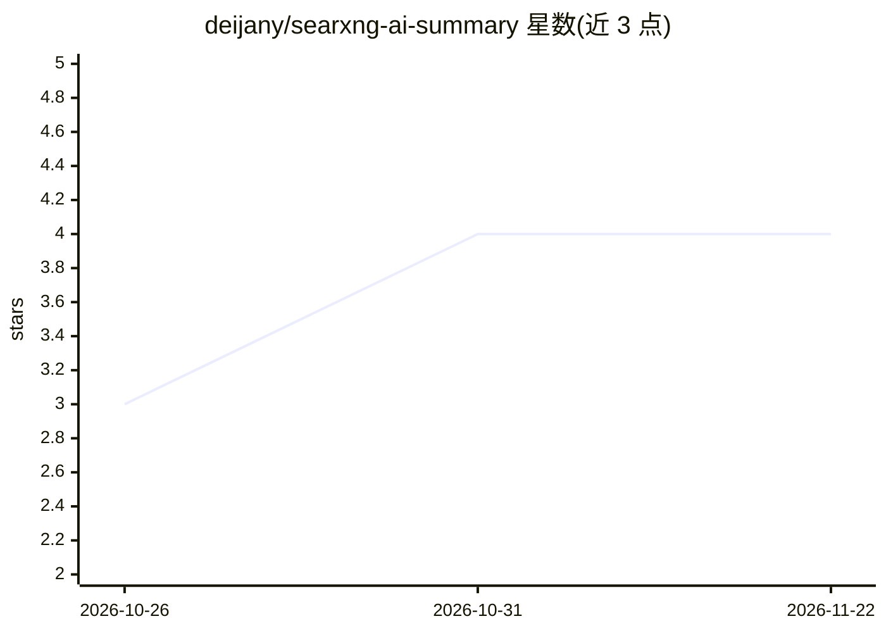

# deijany/searxng-ai-summary

⭐ 4 · Python · MIT · 推送 2026-10-20 · [GitHub](https://github.com/deijany/searxng-ai-summary) · [官网](https://hub.docker.com/r/deijany/searxng-ai-summary) · 个人维护

**自托管代理：为 SearXNG 结果叠加可切换模型的 AI 摘要**

以反向代理形式部署在 SearXNG 前端，不改 SearXNG 本体，升级不受影响。注入脚本读取页面上的标题、URL 与摘要片段，请求 `/_ai/summarize` 由任意 OpenAI 兼容端点（LiteLLM、OpenAI、Anthropic、DeepSeek、Kimi、llama.cpp、LM Studio、vLLM、Ollama）生成流式摘要，带可点击引用编号；支持每浏览器记忆的模型下拉切换、按标签页缓存摘要、模型数量/长度/限流等可配置项。通过 docker compose 部署，提供本地 docker build 途径。

## 筛选速览

| 维度 | 判定 | 备注 |
|---|---|---|
| AI 角色 | `ai-enhanced` | 去掉 AI 部分产品仍成立 |
| 许可风险 | `permissive` | MIT |
| 部署形态 | `self-host` | docker 或自建部署 |
| 模型依赖 | local-ok | 支持本地模型 |
| 硬件要求 | — | 无带数字的原话,不猜 |
| 安装摩擦 | `low` | 无编译、无系统依赖或容器化 |
| 成熟度 | — | 结构信号不足 |

## 能力要点

- 代理方式接入，无需修改 SearXNG，升级不失效
- 支持任意 OpenAI 兼容端点，含本地与云端模型
- 流式摘要与可点击 [n] 引用，按标签页缓存避免重复调用
- AUTO_SUMMARIZE、MAX_RESULTS、RATE_LIMIT 等配置项

## 适用场景

- 给自己的 SearXNG 自托管实例加 AI 摘要
- 用本地模型（如 Ollama）避免摘要请求消耗云端额度
- 在多模型之间切换对比搜索结果的摘要

## 场景标签

`RAG` · 领域:知识与检索

## 证据(README 行号)

> L3: AI summaries on top of your SearXNG results, from any OpenAI-compatible endpoint: LiteLLM, OpenAI, Anthropic, DeepSe
> L6: - No SearXNG changes: runs as a small proxy in front of it, survives SearXNG updates
> L19: browser --> searxng-ai-summary --> SearXNG

## 星数曲线

2026-10-26 3 → 2026-11-22 4（+1）

---
*卡片 v1 · prompt 1.4 · 生成 2026-11-21 · 置信度 high · 依据 README sha `f02dfd782f36` · [字段定义](../../DATASET.md)*
