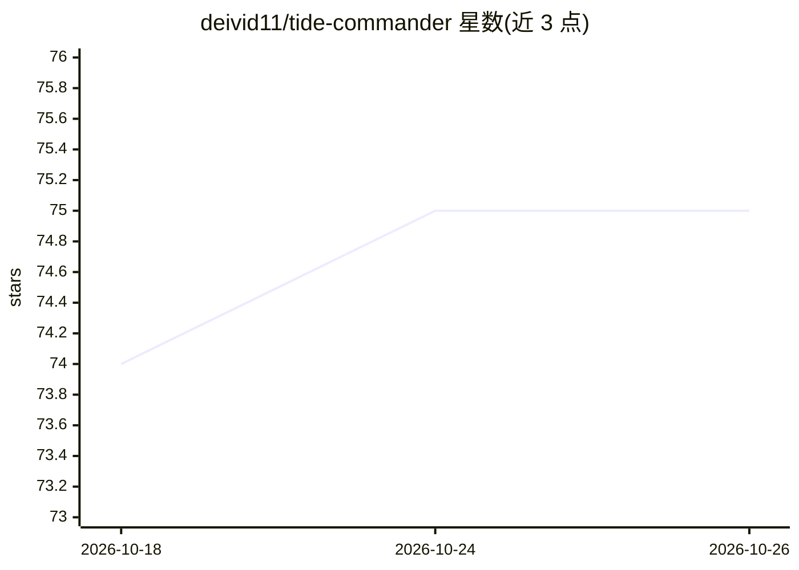

# deivid11/tide-commander

⭐ 75 · TypeScript · MIT · 推送 2026-10-02 · [GitHub](https://github.com/deivid11/tide-commander) · [官网](https://tidecommander.com/) · 个人维护

**多 AI agent CLI 的可视化管理与编排工作台**

面向使用 Claude Code、Codex、OpenCode、Grok、Pi 等 agent CLI 的开发者，提供统一 Web 界面：以 boss/下属 agent 团队组织并行工作，将各 harness 的事件流归一化为统一的会话与工具卡片视图，并在 agent 之间迁移会话（Smart Context/Fresh Start）。内置多根文件浏览器、Git 集成、Markdown/Mermaid/3D 等富预览、工作流状态机、触发器与本地插件系统，支持 HTTPS/令牌的远程访问。需 Node.js 18+ 与至少一个受支持 agent CLI，通过 npx/npm 安装，浏览器访问 localhost:6200 使用。

## 筛选速览

| 维度 | 判定 | 备注 |
|---|---|---|
| AI 角色 | `ai-ecosystem` | LLM/agent 周边工具 |
| 许可风险 | `permissive` | MIT |
| 部署形态 | `self-host` | docker 或自建部署 |
| 模型依赖 | locked-api |  |
| 硬件要求 | — | 无带数字的原话,不猜 |
| 安装摩擦 | `low` | 无编译、无系统依赖或容器化 |
| 成熟度 | — | 结构信号不足 |

## 能力要点

- 并行管理 Claude Code/Codex/OpenCode/Grok/Pi 五种 agent CLI，事件流归一化
- boss/下属 agent 团队编排、任务标签与跟踪状态
- 跨 harness 会话迁移（Smart Context/Visible Transcript/Fresh Start）
- 工作流状态机、webhook/cron 触发器与本地插件、技能系统

## 适用场景

- 我同时用多个 AI agent CLI，想在一个界面里管理它们的并行工作
- 按项目分区组织 agent 团队并追踪任务状态
- 从手机或浏览器扩展远程接管同一批服务端会话

## 场景标签

`编码 Agent` `多智能体` · 领域:Agent 开发

## 证据(README 行号)

> L21: > **More than an agent manager. More than an IDE.** Tide Commander is a complete build environment designed around 
> L73: |Harness|Required command|Default runtime|Optional persistent/streaming mode|
> L75: |**Claude Code**|`claude`|Headless `stream-json` process with stdin follow-ups|Interactive Claude TUI in tmux; gene

## 星数曲线

2026-10-18 74 → 2026-10-26 75（+1）

---
*卡片 v1 · prompt 1.4 · 生成 2026-10-24 · 置信度 high · 依据 README sha `0b28c69ef754` · [字段定义](../../DATASET.md)*
