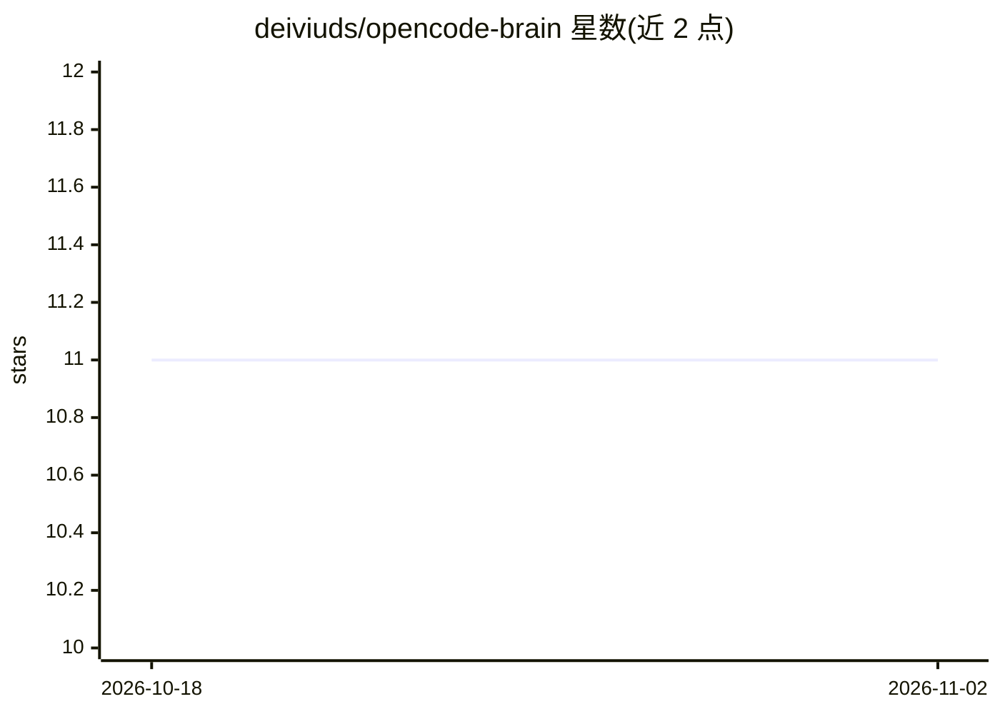

# deiviuds/opencode-brain

⭐ 11 · TypeScript · MIT · 推送 2026-01-30 · [GitHub](https://github.com/deiviuds/opencode-brain) · 个人维护

**给 OpenCode 加跨会话记忆的插件，单文件存储**

OpenCode 的 npm 插件，基于 memvid（Rust 核心）将工具输出、会话决策、问题与解决方案等捕获为分类观察记录，存入项目内单个 .claude/mind.mv2 文件，会话启动时自动注入并可搜索。与 claude-brain 插件读写同一文件，使 OpenCode 与 Claude Code 共享项目记忆。无数据库、无云端、无 API key；大输出自动压缩至约 500 tokens，支持文件锁、损坏备份与 git 版本控制。

## 筛选速览

| 维度 | 判定 | 备注 |
|---|---|---|
| AI 角色 | `ai-ecosystem` | LLM/agent 周边工具 |
| 许可风险 | `permissive` | MIT |
| 部署形态 | `library` | 以包/库形式分发 |
| 模型依赖 | — | README 未给出锁定关系 |
| 硬件要求 | — | 无带数字的原话,不猜 |
| 安装摩擦 | `low` | 无编译、无系统依赖或容器化 |
| 成熟度 | — | 结构信号不足 |

## 能力要点

- 单文件 .mv2 存储全部记忆，可 git 提交与 scp 传输
- 与 claude-brain 兼容，OpenCode 与 Claude Code 共享同一记忆文件
- 观察自动分类为 10 种类型（decision/problem/solution 等）
- 大输出自动压缩，10K+ 记忆搜索 <1ms

## 适用场景

- 让 OpenCode 记住之前会话中的调试与决策上下文
- 在 Claude Code 与 OpenCode 间共享项目记忆
- 通过 git 提交记忆文件实现团队上下文交接

## 场景标签

`Agent 记忆` · 领域:Agent 开发

## 证据(README 行号)

> L3: ### Give OpenCode photographic memory in ONE portable file.
> L10: Using claude-brain and Memvid.
> L44: npm install opencode-brain

## 星数曲线

2026-10-18 11 → 2026-11-02 11（+0）

---
*卡片 v1 · prompt 1.4 · 生成 2026-11-02 · 置信度 high · 依据 README sha `7451c5dc2c94` · [字段定义](../../DATASET.md)*
