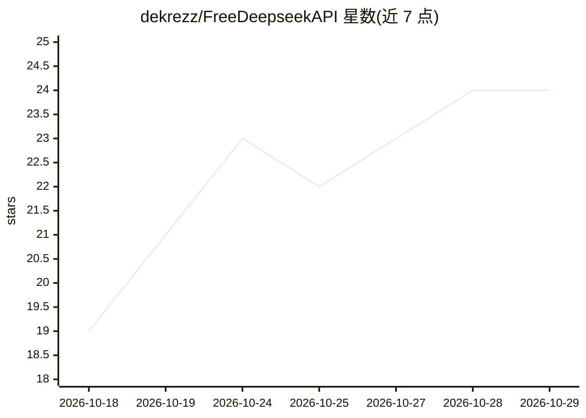

# dekrezz/FreeDeepseekAPI

⭐ 24 · JavaScript · Apache-2.0 · 推送 2026-10-16 · [GitHub](https://github.com/dekrezz/FreeDeepseekAPI) · 个人维护 · 中文 README

**把 DeepSeek 网页版账号封装成本地 OpenAI 兼容 API 的代理**

在本地运行的 API 代理服务器：用户用自己的 chat.deepseek.com 免费账号，通过 Chrome 登录保存会话（deepseek-auth.json），代理在 127.0.0.1:9655 提供 OpenAI 兼容接口（/v1/chat/completions），并带 Anthropic Messages 与 OpenAI Responses shim，可接入 Open WebUI、Cursor、Claude Code、Codex 等客户端。支持流式 SSE、DeepThink 推理内容、DeepSeek 原生 Web 搜索、工具调用与按 agent 会话复用。零 npm 依赖，需 Node.js 18+ 与 Chrome；README 自述为实验性代理，依赖 DeepSeek 私有 Web API，可能随其变更失效。提供 npm 脚本与 Rootless Podman 容器两种运行方式。

## 筛选速览

| 维度 | 判定 | 备注 |
|---|---|---|
| AI 角色 | `ai-ecosystem` | LLM/agent 周边工具 |
| 许可风险 | `permissive` | Apache-2.0 |
| 部署形态 | `desktop` | 安装包/桌面程序 |
| 模型依赖 | locked-api |  |
| 硬件要求 | — | 无带数字的原话,不猜 |
| 安装摩擦 | `low` | 无编译、无系统依赖或容器化 |
| 成熟度 | `idea` | |

## 能力要点

- OpenAI 兼容 /v1/chat/completions，另有 Anthropic Messages 与 OpenAI Responses shim
- 复用登录后的 DeepSeek Web 会话，无需付费 API key
- 按 agent/user 的会话复用、空回复重试与超长提示截断（默认 80,000 字符）
- 零 npm 依赖（Node.js 18+），提供 Rootless Podman 容器方案

## 适用场景

- 把免费 DeepSeek 网页账号接到 Open WebUI、Cursor 等本地客户端当 API 用
- 让 Claude Code、Codex 等编码 agent 通过一条命令切换到 DeepSeek 后端
- 在 VPS 上无头部署该代理并通过 /readyz 与 doctor 做诊断

## 场景标签

`模型网关` · 领域:Agent 开发

## 证据(README 行号)

> L5:  Local OpenAI-compatible API proxy for DeepSeek Web Chat
> L68: FreeDeepseekAPI runs a local API server in front of **DeepSeek Web Chat** (chat.deepseek.com). Point Open WebUI, Li
> L70: The project uses your normal logged-in DeepSeek account. The local server accepts API requests, then continues that

## 星数曲线

2026-10-18 19 → 2026-10-29 24（+5）

---
*卡片 v1 · prompt 1.4 · 生成 2026-10-27 · 置信度 high · 依据 README sha `350c6256492d` · [字段定义](../../DATASET.md)*
