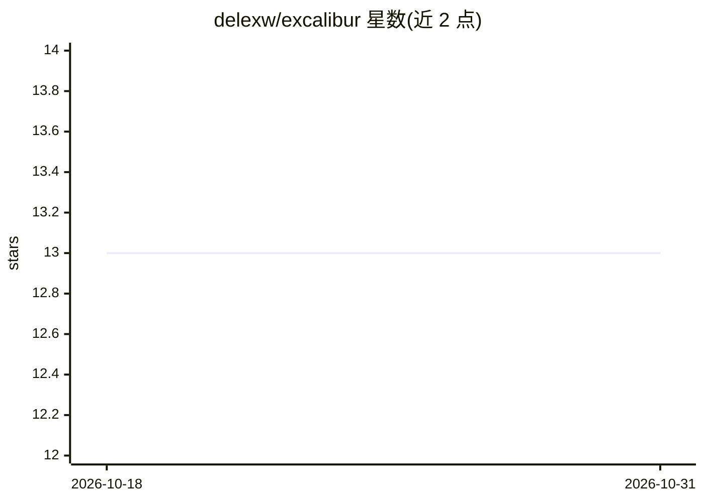

# delexw/excalibur

⭐ 13 · TypeScript · MIT · 推送 2026-02-27 · [GitHub](https://github.com/delexw/excalibur) · 个人维护

**让多个 AI agent 结构化辩论并投票达成共识的 CLI 编排工具**

Excalibur CLI 是协调多个已安装的 agent CLI（通过 agents.json 配置）进行结构化辩论的终端工具：流程为提案→批评→投票循环，直至按 unanimous/super/majority 阈值达成共识；支持 owner 审批机制（指定 agent 需在投票中给获胜提案打出达标分数）、橡皮图章惩罚、逐 agent 日志。在项目目录内运行时 agent 可读取代码库以生成贴合上下文的方案。要求 Node.js ≥ 18 且各 agent CLI 已安装可运行；通过 npm 从源码全局安装，仅用 Node 内置模块，提示词在 prompts/*.md 中可定制。

## 筛选速览

| 维度 | 判定 | 备注 |
|---|---|---|
| AI 角色 | `ai-ecosystem` | LLM/agent 周边工具 |
| 许可风险 | `permissive` | MIT |
| 部署形态 | `library` | 以包/库形式分发 |
| 模型依赖 | — | README 未给出锁定关系 |
| 硬件要求 | — | 无带数字的原话,不猜 |
| 安装摩擦 | `low` | 无编译、无系统依赖或容器化 |
| 成熟度 | — | 结构信号不足 |

## 能力要点

- 提案→批评→投票循环直至达成共识（三种共识模式可配置阈值）
- owner 审批系统：指定 agent 投票分数需达到阈值方可通过
- agent 可读取项目代码库，生成贴合现有架构的方案
- 交互式终端：命令过滤、Tab 补全、ESC 终止 agent；逐 agent 日志

## 适用场景

- 让多个 AI agent 辩论并投票，选出某个技术问题的共识方案
- 在项目目录内让 agent 结合现有代码风格给出实现建议
- 通过 owner 审批机制对共识结果追加质量门槛

## 场景标签

`多智能体` `Agent 框架` · 领域:Agent 开发

## 证据(README 行号)

> L10: **Excalibur CLI** coordinates AI agents in structured debates to reach consensus on solutions. Features interactive
> L17: - **Structured Debates** — Proposal → critique → vote cycles until consensus

## 星数曲线

2026-10-18 13 → 2026-10-31 13（+0）

---
*卡片 v1 · prompt 1.4 · 生成 2026-10-31 · 置信度 high · 依据 README sha `4f076ce2253b` · [字段定义](../../DATASET.md)*
