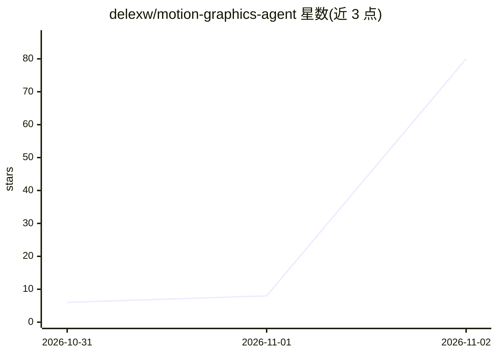

# delexw/motion-graphics-agent

⭐ 80 · TypeScript · MIT · 推送 2026-11-01 · [GitHub](https://github.com/delexw/motion-graphics-agent) · 个人维护 · 中文 README

**把创意变成动态图形短片的本地 AI 视频生成代理**

Kiteva 是一个本地优先的 AI 动态图形代理：用户输入创意，由 Claude Opus 5.5 或 GPT-6.1 Sol 作为主模型规划并生成短篇动态图形影片，含本地 TTS 旁白（Ming 3.0 / Kokoro）、代码生成的配乐与音效、字幕与多语言轨道。提供网页界面（端口 18419/后端 18417），并通过 /mcp 端点向外部 agent 开放搜索创意、保存草稿、导入资产与启动构建等工具。支持版本迭代、修正重试、渲染缓存恢复与人工登录接力等机制。

## 筛选速览

| 维度 | 判定 | 备注 |
|---|---|---|
| AI 角色 | `ai-native` | 本体是模型或模型工具 |
| 许可风险 | `permissive` | MIT |
| 部署形态 | `library` | 以包/库形式分发 |
| 模型依赖 | locked-api |  |
| 硬件要求 | — | 无带数字的原话,不猜 |
| 安装摩擦 | `low` | 无编译、无系统依赖或容器化 |
| 成熟度 | — | 结构信号不足 |

## 能力要点

- Claude Opus 5.5 / GPT-6.1 Sol 作为主模型生成动态图形影片
- HTTP MCP 服务器供外部 agent 调用（搜索/草稿/资产导入/启动构建）
- 本地 TTS 旁白（Ming 3.0 0.5B、Kokoro）与多语言 narration/字幕轨道
- Production Desk 检视器：回放、波形、分轨音频与故事板元数据

## 适用场景

- 用一句话创意生成带旁白和配乐的动画短片
- 通过外部 agent（MCP）编排创意与构建流程
- 多语言版本输出与字幕/音频分轨下载

## 场景标签

`视频生成` `编码 Agent` · 领域:编码与开发

## 证据(README 行号)

> L13:  A personal creative room where an idea turns into a short motion-graphics film.
> L14:  Create with Claude Opus 5.5 or GPT-6.1 Sol.
> L39: - **HTTP MCP for external agents:** search saved ideas and Motion Graphics, inspect available settings, save an Ass

## 星数曲线

2026-10-31 6 → 2026-11-02 80（+74）

---
*卡片 v1 · prompt 1.4 · 生成 2026-11-02 · 置信度 mid · 依据 README sha `cf08cd6cb75c` · [字段定义](../../DATASET.md)*
