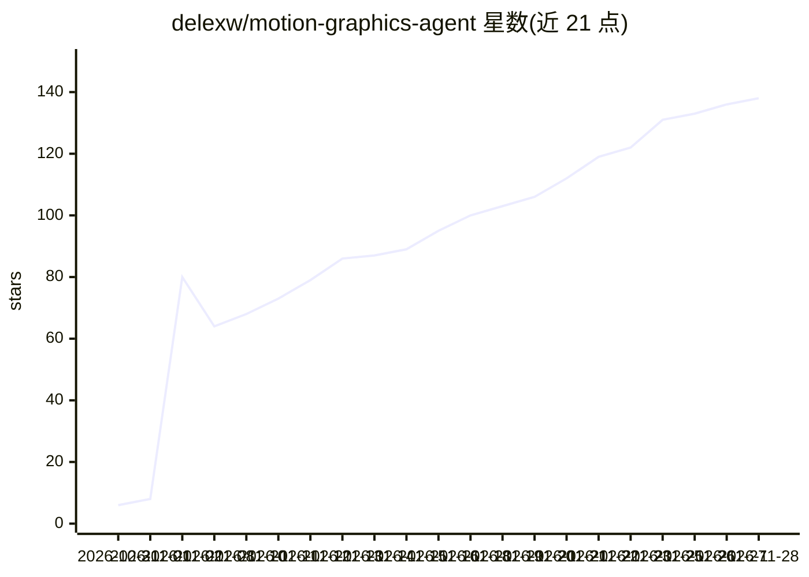

# delexw/motion-graphics-agent

⭐ 138 · TypeScript · MIT · 推送 2026-11-27 · [GitHub](https://github.com/delexw/motion-graphics-agent) · 个人维护 · 中文 README

**桌面式 AI 工作室：把创意变成动态图形与动画短片**

Kiteva 是一个桌面式「创意房间」，用户在窗口界面中从一个想法出发，经由 brief 生成、Motion Graphic 组合提议、评分筛选、静音预览、完整影片渲染与审查修复的流程，产出 1080p/1440p 的 MP4 影片（最长 5 分钟），支持字幕与本地旁白（Kokoro/Pocket TTS）。模型调用通过外部 agent 或内置 provider（Claude、GPT-6.2 Astra、DeepSeek、Gemini beta），按项目选择；也提供 MCP server 供外部 agent 调用。内置 140 个 Motion Graphics 目录与 92 条技术池推荐。非设计者也可上手，按 MIT 许可开源。

## 筛选速览

| 维度 | 判定 | 备注 |
|---|---|---|
| AI 角色 | `ai-native` | 本体是模型或模型工具 |
| 许可风险 | `permissive` | MIT |
| 部署形态 | `library` | 以包/库形式分发 |
| 模型依赖 | locked-api |  |
| 硬件要求 | — | 无带数字的原话,不猜 |
| 安装摩擦 | `low` | 无编译、无系统依赖或容器化 |
| 成熟度 | — | 结构信号不足 |

## 能力要点

- 140 个 Motion Graphics 目录组合提议，JEV 评估器打分筛选
- 完整影片渲染后经 ffprobe 探测、解码与布局/对比度检查并修复
- MCP server 支持外部 agent 搜索、存草稿并显式启动构建
- 渲染结果可导出含 OpenTimelineIO 时间线与 SRT 字幕的可编辑项目 ZIP

## 适用场景

- 把一个文字创意快速变成带旁白字幕的短视频
- 为内部演示或科普内容生成动态图形短片
- 通过 MCP 让自己的 agent 调用影片构建能力
- 浏览 136 个 Motion Graphics 示例寻找视觉方向

## 场景标签

`视频生成` · 领域:内容生成

## 证据(README 行号)

> L13:  A personal creative room where an idea turns into a short motion-graphics film.
> L112: - **Motion Graphic combinations.** The main model reads summaries of all 140 Motion Graphics and
> L116: - **The full film** continues the preview session you picked, at 1080p or 1440p, 30 or 60 fps, up to

## 星数曲线

2026-10-31 6 → 2026-11-28 138（+132）

---
*卡片 v1 · prompt 1.4 · 生成 2026-11-28 · 置信度 high · 依据 README sha `9796d0666f04` · [字段定义](../../DATASET.md)*
