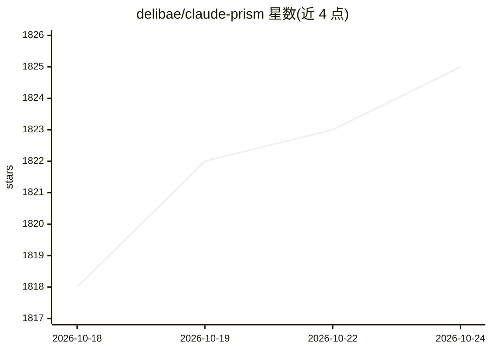

# delibae/claude-prism

⭐ 1,825 · TypeScript · MIT · 推送 2026-08-28 · [GitHub](https://github.com/delibae/claude-prism) · [官网](https://claudeprism.delibae.dev) · 个人维护 · 中文 README

**本地优先的科研写作桌面工作台：LaTeX+Python+Claude 助手**

面向科研写作者的桌面应用（Tauri 2 + Rust），内嵌 Tectonic 实现离线 LaTeX 编译，集成 uv 一键创建 Python 虚拟环境供 Claude 运行分析脚本，可从 K-Dense 安装 100+ 领域科学技能到 ~/.claude/skills/。AI 助手支持 Sonnet/Opus/Haiku 选择与工具调用，文档保存在本地并通过本地 Git 仓库做快照与 diff 回滚；AI 功能使用时 prompt 与文件内容会发送至 Anthropic API。提供 macOS/Windows/Linux 安装包，MIT 许可。

## 筛选速览

| 维度 | 判定 | 备注 |
|---|---|---|
| AI 角色 | `ai-enhanced` | 去掉 AI 部分产品仍成立 |
| 许可风险 | `permissive` | MIT |
| 部署形态 | `desktop` | 安装包/桌面程序 |
| 模型依赖 | locked-api |  |
| 硬件要求 | — | 无带数字的原话,不猜 |
| 安装摩擦 | `low` | 无编译、无系统依赖或容器化 |
| 成熟度 | — | 结构信号不足 |

## 能力要点

- 内嵌 Tectonic 离线 LaTeX 编译，无需 TeX Live
- 集成 uv 一键创建项目级 Python 虚拟环境
- 可安装 100+ 领域科学技能（生物信息、化学信息、ML 等）
- 本地 Git 快照历史、逐块接受/拒绝 AI 修改建议

## 适用场景

- 在本地离线撰写与编译 LaTeX 论文/学位论文/海报
- 让 Claude 直接运行 Python 做数据分析并生成图表
- 按领域安装科学技能辅助专业写作与文献综述
- 通过截图向 Claude 询问 PDF 中的公式、图表或审稿意见

## 场景标签

`科研工具` `AI 写作` `数据分析` · 领域:效率与自动化

## 证据(README 行号)

> L5:  An offline-first scientific writing workspace powered by Claude.
> L39: ClaudePrism is a **local-first** alternative — your files are stored on your disk, compiled offline, and edited loc

## 星数曲线

2026-10-18 1,818 → 2026-10-24 1,825（+7）

---
*卡片 v1 · prompt 1.4 · 生成 2026-10-21 · 置信度 high · 依据 README sha `ea5c80352f15` · [字段定义](../../DATASET.md)*
