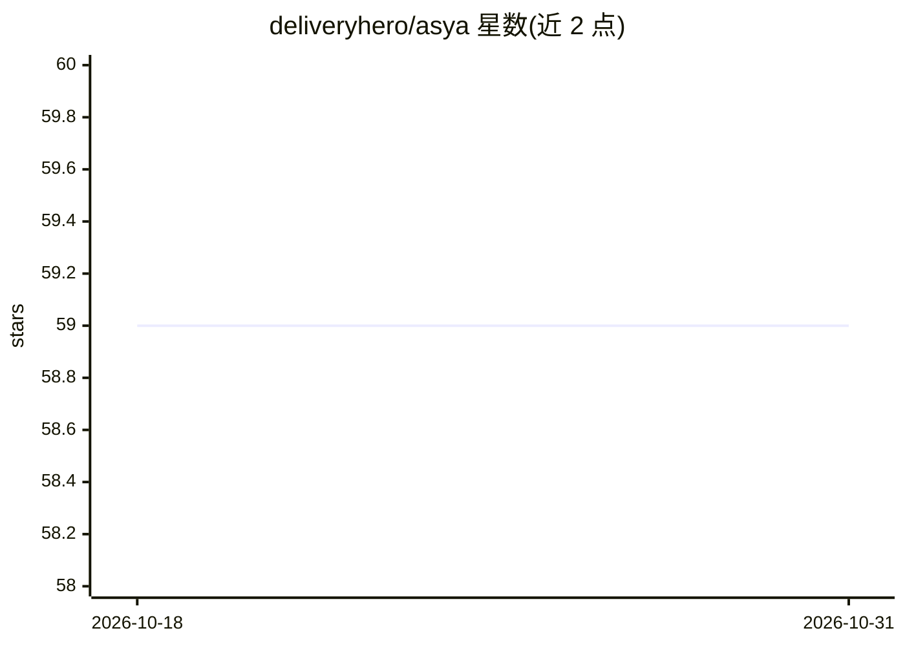

# deliveryhero/asya

⭐ 59 · Python · Apache-2.0 · 推送 2026-09-17 · [GitHub](https://github.com/deliveryhero/asya) · [官网](https://asya.sh) · 组织维护

**K8s 上的分布式 actor mesh，承载异步 AI/ML 管道**

面向 AI 工作负载的 Kubernetes 原生 actor 框架：开发者以纯 Python 函数编写 handler，平台侧以 CRD（AsyncActor）声明部署，消息自带路由（prev/curr/next 队列），无中心协调器。支持 KEDA 按 actor 队列独立伸缩至零以减少 GPU 空闲开销，支持 SQS/RabbitMQ/GCP Pub/Sub 多种传输，并提供 A2A 与 MCP 网关将管道暴露为 agent 或工具。安装方式为 Helm chart，Apache 2.0 许可，源自 Delivery Hero 三年生产实践，项目自述仍处于成长阶段。

## 筛选速览

| 维度 | 判定 | 备注 |
|---|---|---|
| AI 角色 | `ai-ecosystem` | LLM/agent 周边工具 |
| 许可风险 | `permissive` | Apache-2.0 |
| 部署形态 | `library` | 以包/库形式分发 |
| 模型依赖 | — | README 未给出锁定关系 |
| 硬件要求 | — | 无带数字的原话,不猜 |
| 安装摩擦 | `low` | 无编译、无系统依赖或容器化 |
| 成熟度 | `idea` | |

## 能力要点

- 纯 Python handler（无 SDK 导入）+ CRD 声明部署，两文件分工
- 去中心化路由：消息信封自带 prev/curr/next 队列，无协调器
- KEDA 按队列独立伸缩，支持 scale to zero
- 多传输（SQS/RabbitMQ/GCP Pub/Sub）与 A2A + MCP 网关（流式、暂停/恢复）

## 适用场景

- 在 K8s 上编排突发性、GPU 密集的多步 AI 工作负载
- 数据科学家写 handler、平台团队管部署规范的分工协作
- 将 actor 管道以 A2A agent 或 MCP 工具形式对外暴露
- 运行时动态改写路由实现 agentic 分支与 LLM judge 流程

## 场景标签

`Agent 框架` `工作流自动化` · 领域:Agent 开发

## 证据(README 行号)

> L14: 🎭 Asya is a Kubernetes-native **actor mesh** for async AI/ML pipelines. Each actor is a pure Python
> L19: AI workloads are **batch jobs** — bursty, GPU-heavy, multi-step. Forcing them into synchronous

## 星数曲线

2026-10-18 59 → 2026-10-31 59（+0）

---
*卡片 v1 · prompt 1.4 · 生成 2026-10-24 · 置信度 high · 依据 README sha `36ff0a698ef8` · [字段定义](../../DATASET.md)*
