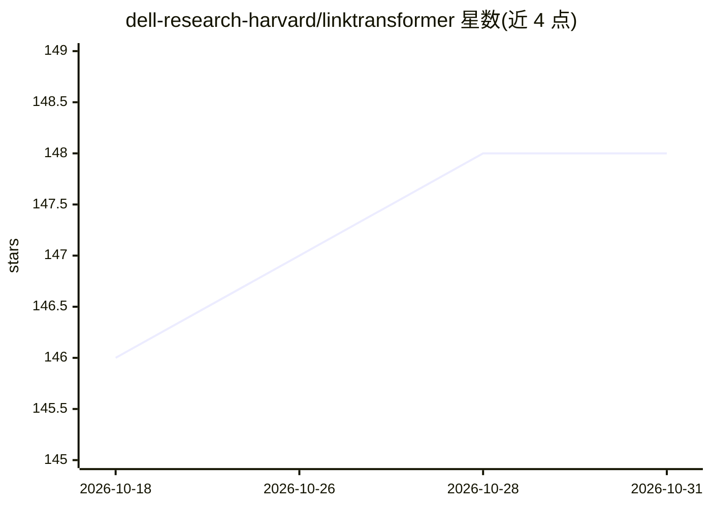

# dell-research-harvard/linktransformer

⭐ 148 · Python · GPL-3.0 · 推送 2026-10-15 · [GitHub](https://github.com/dell-research-harvard/linktransformer) · [官网](https://linktransformer.github.io/) · 组织维护

**面向表格数据的语义记录链接与去重 Python 库**

基于深度学习嵌入的 Python 包，在 pandas 表格上执行语义记录链接、top-k 候选检索、行级 LLM 变换、聚类去重与文本分类；新增 merge_k_judge 端到端流程（嵌入检索 + LLM 判定并返回置信度）。支持 HF/SBERT 本地嵌入模型与 OpenAI、Gemini API 模型，可混合提供方组合，并能从配对数据训练链接模型。由哈佛 Dell Research 团队维护，附 arXiv 论文与 Colab 教程。

## 筛选速览

| 维度 | 判定 | 备注 |
|---|---|---|
| AI 角色 | `ai-native` | 本体是模型或模型工具 |
| 许可风险 | `viral` | GPL-3.0 |
| 部署形态 | `library` | 以包/库形式分发 |
| 模型依赖 | — | README 未给出锁定关系 |
| 硬件要求 | — | 无带数字的原话,不猜 |
| 安装摩擦 | `low` | 无编译、无系统依赖或容器化 |
| 成熟度 | — | 结构信号不足 |

## 能力要点

- merge_k_judge：嵌入检索 top-k + LLM 判定的端到端记录链接，返回置信度
- merge/merge_knn/merge_blocking 语义链接与 aggregate_rows 行聚合
- transform_rows 用 LLM 规范化列值（如修 OCR 错误）
- cluster_rows/dedup_rows 聚类去重与 train_model 训练链接模型

## 适用场景

- 把两个数据表按公司名等字段做模糊匹配链接
- 对表格数据去重并保留代表性行
- 用 LLM 批量修正、规范化列值
- 对行级文本做分类或训练自定义链接模型

## 场景标签

`语义搜索` · 领域:知识与检索

## 证据(README 行号)

> L6: LinkTransformer is a Python package for semantic record linkage, candidate retrieval, row transformation, clustering
> L111: - API embedding models and local SBERT models are both supported.

## 星数曲线

2026-10-18 146 → 2026-10-31 148（+2）

---
*卡片 v1 · prompt 1.4 · 生成 2026-10-22 · 置信度 high · 依据 README sha `0d8a4174786a` · [字段定义](../../DATASET.md)*
